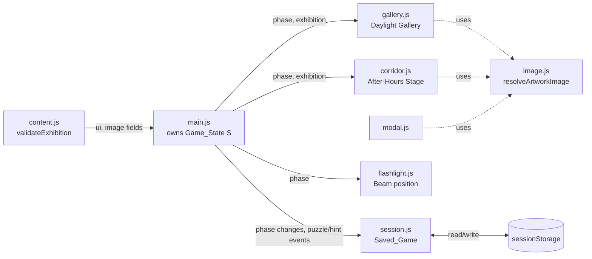

# Design Document

## Overview

This design splits the single shared corridor into two purpose-built views that share one `state.js` machine:

- **Daylight Gallery** (`#daylight-gallery`, new `assets/js/gallery.js`): a static isometric corner-gallery scene built once per Exhibition load, with CSS-only lighting.
- **After-Hours Stage** (`#stage`, existing `assets/js/corridor.js`, extended): the first-person corridor, now reset to a fixed entrance pose on every entry, lit by a pointer-tracked flashlight.

A new `assets/js/session.js` module persists the in-progress After-Hours game to `sessionStorage` so a reload cannot drop the player back into the gallery. A new `assets/js/flashlight.js` module owns the pointer-to-`--mx/--my` wiring. `main.js` keeps its role as the only module that owns `S` (the `Game_State`) and wires phase transitions to both views, `session.js`, and `flashlight.js`.

Both new visual modules reuse the existing `artGradient` fallback rather than duplicating it. Image support is added as a single `resolveArtworkImage` helper used identically by the gallery, the plaque modal, and the corridor, so the three views cannot disagree about which fill an Artwork gets.



## Architecture

### Module boundaries

| Module | Role | DOM/storage at import time? |
|---|---|---|
| `assets/js/state.js` | Game_State machine (unchanged transitions, extended with a restore function) | No (unchanged rule) |
| `assets/js/gallery.js` (new) | Daylight Gallery: builds/destroys the Gallery_Scene, frame placement, click/keyboard activation, viewed marker, responsive sizing | Pure helpers importable in Node; DOM-building functions run only when called |
| `assets/js/corridor.js` (extended) | After-Hours Stage: unchanged geometry (`computeLayout`), extended with an `entrancePose()`/reset-to-entrance step and a pose getter for tests | Same rule as today |
| `assets/js/flashlight.js` (new) | Pointer/focus → `--mx`/`--my`, rAF throttle, reduced-motion and no-pointer defaults | Pure position math importable in Node; DOM listener wiring behind an init function |
| `assets/js/session.js` (new) | Saved_Game serialize/parse/validate, `sessionStorage` read/write with try/catch, Game_State restore | Serializer/parser/restore are pure; storage access is parameterized (defaults to `sessionStorage`, injectable for tests) |
| `assets/js/image.js` (new) | `resolveArtworkImage`, `isSafeArtworkImagePath` — pure path/selection rules shared by gallery, modal, corridor | Pure, Node-importable |
| `assets/js/content.js` (extended) | Adds `ui` object and per-artwork `image`/`hauntedImage`/`alt`/`credit` validation | Unchanged rule (pure) |
| `assets/js/main.js` (extended) | Boot, phase→view wiring, `render()`, Direct_Entry (`?mode=afterhours`), session wiring, Escape_CTA / Confirmation_Dialog | Unchanged rule (DOM owner) |

This satisfies Requirement 15.4–15.5: Daylight code lives only in `gallery.js`, Corridor code stays in `corridor.js`, and every pure part (`image.js`, the Saved_Game functions in `session.js`, Base_Width/Base_Height in `gallery.js`, frame placement in `gallery.js`) is importable in Node without touching the DOM at import time, matching the existing pattern in `corridor.js` and `content.js`.

### Phase → view wiring

`main.js` keeps a single `render()` that is the only place writing state-derived DOM (per the existing comment in `main.js`). It is extended to toggle which top-level view is visible and inert:

```js
function render() {
  const ph = S.phase, inAfterHours = ph !== "gallery";
  root.dataset.theme = themeFor(ph);
  gallery.setVisible(!inAfterHours);     // hidden + inert when false
  stageToggle(inAfterHours);              // #stage hidden + inert when false
  flashlight.setActive(inAfterHours);
  // ...existing slots/progress/lock rendering unchanged...
}
```

`gallery.setVisible(false)` and the Stage toggle use `hidden` plus `inert` (Requirement 7.5), mirroring the existing `setInert` helper in `modal.js`. No Haunted_Painting or Exit_Door is focusable while `hidden`/`inert` is applied, satisfying Requirement 7.6 for free (native `hidden`/`inert` remove elements from the tab order).

## Components and Interfaces

### `assets/js/gallery.js`

```js
// Pure — Node-importable
export function computeBaseSize(viewport, topBarHeight) // -> { width, height }
export function placeFrames(artworkCount)               // -> [{ index, side: "left"|"right" }]
export function frameLabel(ui, artwork, index, count)    // accessible name for a Frame

// DOM-owning
export function buildGallery(exhibition, hooks, opts)   // -> { setVisible, markViewed, destroy }
```

- `computeBaseSize({width, height}, topBarHeight)` is the pure function required by 5.7. It mirrors `viewScale()` in `corridor.js` in spirit (clamped scale factors) but returns absolute `--base-width`/`--base-height` pixel values bounded by the viewport minus the top bar, per Requirement 5.6.
- `placeFrames(n)` returns one entry per artwork, `side: index % 2 === 0 ? "left" : "right"`, reusing the exact rule `corridor.js` already uses for `WALL_X` placement (`i % 2 ? 1 : -1`), so the two views agree on left/right without sharing DOM code.
- `buildGallery` is modeled directly on `buildCorridor`: it removes any previous `.frame` elements before rendering (Requirement 2.6), builds one `<button class="frame">` per Artwork from `placeFrames`, wires click/Enter/Space to `hooks.onArtwork(i)`, and exposes `markViewed(i)` for the caller to call after `markViewed(state, id)` succeeds (same split of concerns as `corridor.markDone`).
- A single top-level `.gallery-scene[style*=perspective]` with `transform-style: preserve-3d` nests `.base` (floor), `.leftside`, `.rightside`, two `.walllight` sconces, one `.ground` reflection, and the frames — satisfying Requirement 1.2–1.6 structurally.
- `Requirement 6.6` fallback: `buildGallery` checks `CSS.supports("transform-style", "preserve-3d")` (or a feature probe already used elsewhere) and, if unsupported, renders a flat `<ul>` list of frames instead of the 3D scene, reusing the same `placeFrames`/`frameLabel` data so content never duplicates.

### `assets/js/image.js`

```js
export const ART_IMAGE_DIR = "assets/images/art/";
export const ALLOWED_IMAGE_EXT = [".jpg", ".jpeg", ".png", ".webp"];

export function isSafeArtworkImagePath(value) // -> boolean
export function resolveArtworkImage(artwork, { haunted = false } = {}) // -> { src, alt, credit } | null
```

- `isSafeArtworkImagePath` reuses the same shape of checks as `resolveExhibitionPath` in `content.js` (reject scheme, leading `/` or `//`, backslash, `..` segment, query/fragment) plus the two rules specific to artwork images: must start with `assets/images/art/` and must end in one of `ALLOWED_IMAGE_EXT`.
- `resolveArtworkImage(artwork, {haunted})` returns `{src, alt, credit}` for the day image or (when `haunted: true` and `hauntedImage` is present) the night variant, or `null` when no safe image is available — the caller (gallery, modal, corridor) then falls back to `artGradient(artwork.colors)`. This single function is the one place Requirement 2.12 points to as "the same image-then-gradient fallback function."
- The `` element's `onerror` handler (wired once, in each caller) swaps `src` for the gradient fill and never calls `console.error` (Requirement 2.9) — this part is DOM wiring, not pure logic, and is covered by a unit test with a stubbed `Image`/`` element rather than a property test.

### `assets/js/flashlight.js`

```js
export function clampBeamPosition(x, y, bounds) // pure clamp to viewport, Node-importable
export function initFlashlight(vigEl, { reducedMotion }) // -> { setActive, centerOn, destroy }
```

- `initFlashlight` listens for `pointermove` (mouse, pen, and touch, per Requirement 8.2–8.3) and sets `--mx`/`--my` on `vigEl` through a single `requestAnimationFrame`-throttled writer: a pending position is stored, and only the next animation frame actually commits the CSS variables, satisfying 8.9 ("at most once per animation frame").
- `centerOn(rect)` is called by `main.js`/`corridor.js`/`gallery.js` on every `focus` event delegated from a Haunted_Painting or the Exit_Door, setting the beam to the element's bounding-box center (Requirement 8.7). The corridor already has a `focus` listener per painting (`f.addEventListener("focus", ...)` in `corridor.js`) that currently only walks the camera (`revealForKeyboard`); this design adds a call to `flashlight.centerOn(rect)` alongside it.
- `setActive(false)` (gallery phase) stops listening and resets `--mx`/`--my` to `50%`/`50%` (Requirements 8.4–8.5); `reducedMotion` (from the existing `prefersReducedMotion()` helper in `main.js`, passed in) disables the rAF easing and jumps straight to the new position, matching the "no pointer easing" rule in 13.2.
- The `.vig` element already has `pointer-events: none` in `style.css` (Requirement 8.6 is already satisfied and stays unchanged).
- While a dialog is open (`isOpen()` from `modal.js`), `main.js` calls `setActive(false)` is **not** used (that would also hide the vignette); instead the design keeps the beam position frozen and relies on the existing `.card` not being covered by `.vig` (`z-index` of `.vig` is below the modal, already true today) — Requirement 8.8 is satisfied by the current stacking order, confirmed by an integration test checking computed `z-index`/contrast rather than new logic.

### `assets/js/session.js`

```js
export const STORAGE_KEY = "hexhibit.session.v1";
export const SAVED_GAME_VERSION = 1;

export function serializeSavedGame(state)              // -> string (JSON)
export function parseSavedGame(raw, artworkIds)         // -> SavedGame | null
export function restoreGameState(savedGame, artworkIds) // -> GameState | null  (pure, state.js-compatible)
export function writeSavedGame(state, storage = sessionStorage) // try/catch, no throw
export function readSavedGame(artworkIds, storage = sessionStorage) // try/catch, -> SavedGame | null
export function clearSavedGame(storage = sessionStorage) // try/catch, no throw
```

- `serializeSavedGame`/`parseSavedGame`/`restoreGameState` are pure and Node-importable (Requirement 15.5), matching the pattern of `state.js` itself.
- `parseSavedGame(raw, artworkIds)` performs every validation in Assumption C / Requirement 11.12: valid JSON, known version, `artworkIds` array equal to the loaded Exhibition's ids (order-sensitive, since `revealedDigit` is index-based), `doorCode` a digit string of `artworkIds.length`, and `solved`/`hintsUsed` arrays whose entries are all in `artworkIds`. Any failure returns `null`; it never throws.
- `restoreGameState(savedGame, artworkIds)` builds a `Game_State` object compatible with `state.js`'s shape (`phase`, `artworkIds`, `viewed` (always empty — Daylight viewing isn't persisted), `solved`, `hints`, `currentIndex: 0`, `doorCode`) and derives `phase` as `solved` when `savedGame.solved.length === artworkIds.length`, else `escape` (Requirement 11.5). It returns `null` instead of ever producing `gallery` or `escaped` (Requirement 15.3), which is automatically true because the function only ever picks between `escape`/`solved`.
- `writeSavedGame`/`readSavedGame`/`clearSavedGame` wrap the pure functions with a `storage` parameter (default `sessionStorage`) and a try/catch around every storage call, swallowing quota/availability errors silently (Requirement 11.11, 11.14) — the design injects a fake or throwing storage object in tests, following the same injection pattern `main.js` already uses for `fetchJson` and `byteSource`.
- `main.js` call sites:
  - `enterEscape` success → `writeSavedGame(S)` (Requirement 11.1), also used by Direct_Entry (Requirement 4.18 — same function, same fields).
  - `markSolved` success and `revealHint` success → `writeSavedGame(S)` before the function returns to the event handler, i.e. before the next user action is processed (Requirement 11.2).
  - `submitCode` returning `correct` → `clearSavedGame()` is called synchronously inside the same `if (res === "correct")` branch, before `busy = true`, before `render()`, and before any `setTimeout` (Requirement 11.7 / Assumption M). See the `check()` sequence below.
  - `returnToGallery` call site (`home()`) → `clearSavedGame()` (Requirement 11.8).
  - Boot: before building either view, `main.js` calls `readSavedGame(artworkIds)`; if non-null, `restoreGameState` replaces `createState`'s result and both `corridor`/`gallery` are built directly into the restored phase, skipping the Confirmation_Dialog.

### `assets/js/state.js` (extension only)

Adds one pure function, no change to existing transitions (Requirement 15.1):

```js
export function hydrateState(artworkIds, { doorCode, solved, hints, phase }) // used internally by session.restoreGameState via composition, OR
```

To keep `state.js` the single owner of `Game_State` shape and avoid a second code path that builds a raw object literal, `session.js`'s `restoreGameState` is implemented as a thin wrapper around a new exported `state.js` helper:

```js
// state.js addition
export function createRestoredState(artworkIds, { doorCode, solved, hints }) {
  const s = createState(artworkIds);
  s.doorCode = doorCode;
  solved.forEach((id) => s.solved.add(id));
  hints.forEach((id) => s.hints.add(id));
  s.phase = solved.length === artworkIds.length ? "solved" : "escape";
  return s;
}
```

`session.restoreGameState` calls `createRestoredState` after its own validation, so `state.js` still owns every field of `Game_State` and still never touches `document`/`window`/storage (Requirement 15.2 unchanged).

### `assets/js/content.js` (extension)

- `UI_STRING_FIELDS` (new constant) lists the required `ui` keys (Escape_CTA label, After-Hours hint text, solved marker, viewed marker, locked/unlocked labels, gallery progress template — Requirement 12.1). `validateExhibition` checks each present `ui` field is a string (12.3) and, after validation, a new `applyUiDefaults(exhibition, defaultExhibition)` (called only by `loadExhibitionOrDefault` in `main.js`, not by the pure validator) fills any missing key from the Default_Exhibition's `ui` (12.2, 12.7).
- `validateArtwork` gains four optional fields: `image`, `hauntedImage`, `alt`, `credit`, each checked with `isSafeArtworkImagePath` (imported from `image.js`) for the two path fields, plus the cross-field rules: `hauntedImage` without `image` is an error (12.11); `image` present without `credit`, or `alt`/`credit` present but not a string, is an error (12.12). `colors` stays required and unconditionally validated, so every pre-existing Exhibition (no image fields) keeps validating exactly as before (12.8, 1.13 analog).

### `assets/js/main.js` (extension)

- **Boot** gains Mode_Parameter handling and session restore, replacing the single `boot()` body:

```js
async function boot() {
  // ...existing load/fallback unchanged...
  S = readSavedGame(P.map(a=>a.id)) is tried first (see session.js call sites above);
  if no saved game AND mode === "afterhours": enter escape directly (byteSource), write saved game;
  else: S = createState(...) in "gallery" phase as today;
  gallery = buildGallery(EX, { onArtwork: pick }, {...});
  corridor = buildCorridor(EX, { onArtwork: pick, onDoor: openDoorDialog }, {...});
  flashlight = initFlashlight($("vig"), { reducedMotion: prefersReducedMotion });
  if (restored or direct-entered) corridor.goToEntrance(); // Entrance_Pose, Requirement 7.3/7.10
  if (S.phase !== "gallery") try { history.replaceState(...) } catch {} // strip ?mode, Requirement 4.15
  render();
}
```

- **`check()`** gains the synchronous clear, inserted as the very first statement of the `if (res === "correct")` branch:

```js
if (res === "correct") {
  clearSavedGame();                 // Requirement 11.7 — before anything else below
  const reduced = prefersReducedMotion();
  busy = true; render(); closeDialog(); corridor.walkTo(Infinity);
  setTimeout(() => corridor.openDoor(), ...);
  setTimeout(() => { busy = false; render(); showEscaped(m.escaped) }, ...);
  return;
}
```

- **`home()`** (return to gallery) gains `clearSavedGame()` before `returnToGallery(S)`, and also calls `corridor.goToEntrance()` instead of `corridor.walkTo(0, {instant:true})` so the richer Entrance_Pose reset (yaw/pitch/turn, not just distance) applies (Requirement 7.4).
- **`check()`** for `"art"` mode and `hint()` both gain a `writeSavedGame(S)` call right after `markSolved`/`revealHint` succeed, before `render()` (Requirement 11.2).
- **`$("theme").onclick`** (Escape_CTA) is unchanged in logic; its visible control moves from the top-bar button into the Daylight_Gallery as the Escape_CTA per Requirement 4.1–4.3, but the handler function is the same, now invoked from `gallery.js`'s `hooks.onEscape` callback instead of a `$("theme")` click listener. The top-bar `#theme`/"Locked in"/"Back to gallery" button is removed from `play.html`'s markup for the After-Hours states per Requirement 4.8, replaced by the "Return to the gallery" action already present in `showEscaped`'s dialog.

### Corridor extension (`assets/js/corridor.js`)

```js
export const ENTRANCE_POSE = { d: 0, yaw: 0, pit: 0, fy: 0, td: 0, ty: 0, tp: 0 };
// corridor instance gains:
goToEntrance()  // sets S to ENTRANCE_POSE fields directly (no easing), used on every After-Hours entry/restore/return
getPose()       // read-only snapshot of S, added only so tests can assert Entrance_Pose without reaching into closures
```

`goToEntrance` is a thin wrapper that assigns every field in `ENTRANCE_POSE` onto the internal `S` object (bypassing `td`/`d` easing entirely, per Requirement 7.7, which already asks for the no-easing path during Reduced_Motion — this design applies the same no-easing assignment on every entrance, not only under Reduced_Motion, since Requirement 7.2/7.4 ask for an *instant* set regardless of motion preference). `main.js` calls `corridor.goToEntrance()`:
1. after `buildCorridor` on fresh boot into After-Hours (direct entry or restore) — Requirement 7.2/7.3/7.10.
2. in `home()` before/along with `walkTo(0, {instant:true})` — Requirement 7.4.

## Data Models

### `Saved_Game` (persisted JSON, `sessionStorage[STORAGE_KEY]`)

```ts
{
  v: 1,                    // SAVED_GAME_VERSION
  artworkIds: string[],    // snapshot of the loaded Exhibition's artwork ids, in order
  doorCode: string,        // digits, length === artworkIds.length
  solved: string[],        // subset of artworkIds
  hintsUsed: string[]      // subset of artworkIds
}
```

No other field is persisted (Assumption B). `phase` is intentionally omitted and re-derived by `restoreGameState` (Assumption B, Requirement 11.5).

### Artwork (extended)

```ts
{
  id: string, title: string, artist: string, year: string, medium: string, size: string,
  curatorNote: string, lesson: string, colors: [string, string], puzzle: Puzzle,
  image?: string,         // "assets/images/art/<name>.(jpg|jpeg|png|webp)"
  hauntedImage?: string,  // same path rule; only valid when `image` is present
  alt?: string,
  credit?: string         // required when `image` is present
}
```

### Exhibition `ui` object (new, optional)

```ts
{
  escapeCta?: string,            // Escape_CTA label, default "Enter After-Hours Escape →"
  afterHoursHint?: string,       // hint bar text covering pointer + keyboard
  solvedMarker?: string,         // e.g. "SOLVED"
  viewedMarker?: string,         // e.g. "VIEWED"
  lockedLabel?: string,          // "LOCKED"
  unlockedLabel?: string        // "UNLOCKED"
}
```

Every key is optional at the JSON level but always present after `applyUiDefaults`, which is why `content.schema.json`'s `ui` object has no `required` array but `default-exhibition.json` defines all of them (Requirement 12.1/12.4).

### Entrance Pose (corridor-internal)

`{ d: 0, yaw: 0, pit: 0, fy: 0 }` — camera distance, mouse-look yaw/pitch, and painting-turn offset, all zero. This is the literal definition of Entrance_Pose from the Glossary.

## Correctness Properties

*A property is a characteristic or behavior that should hold true across all valid executions of a system — essentially, a formal statement about what the system should do. Properties serve as the bridge between human-readable specifications and machine-verifiable correctness guarantees.*

After the prework analysis, several closely related acceptance criteria collapse into a single property (e.g., 2.1 and 2.8 both reduce to "frame count equals artwork count"; 11.12's rejection rules and 11.5's phase derivation are tested as one restore-correctness property with sub-cases). The properties below are the deduplicated set.

### Property 1: Frame count and order match the Exhibition

For all artwork counts `n` from 3 to 6, `placeFrames(n)` returns exactly `n` entries, in Exhibition order (entry `i`'s index is `i`), with `side` alternating starting at `"left"` for index 0.

**Validates: Requirements 2.1, 2.2, 2.8**

### Property 2: Base size never exceeds the viewport

For all viewport widths and heights from 360×640 to 1920×1080 and all non-negative top-bar heights up to the viewport height, `computeBaseSize({width, height}, topBarHeight)` returns a `width` no greater than the viewport width and a `height` no greater than `viewport height - topBarHeight`.

**Validates: Requirements 5.6, 5.7**

### Property 3: Image resolution is consistent and safe

For all Artworks (with or without `image`/`hauntedImage`) and for both `haunted: false` and `haunted: true`, `resolveArtworkImage` returns `null` whenever the relevant path is absent or fails `isSafeArtworkImagePath`, and otherwise returns the expected path (day image, or the night variant only when `haunted: true` and `hauntedImage` is present, else the day image).

**Validates: Requirements 2.3, 2.11, 2.12, 2.13**

### Property 4: Unsafe artwork image paths are always rejected

For all strings, `isSafeArtworkImagePath(value)` returns `true` if and only if the value has no scheme, does not start with `/` or `//`, contains no `..` segment, no backslash, no query or fragment, starts with `assets/images/art/`, and ends in `.jpg`, `.jpeg`, `.png`, or `.webp`.

**Validates: Requirements 12.10, 12.14**

### Property 5: Saved_Game round trip

For all valid Game_State values in phase `escape` or `solved` (any `doorCode` of matching length, any subset of artwork ids as `solved` and as `hints`), parsing `serializeSavedGame(state)` with `parseSavedGame` against the same `artworkIds` SHALL produce a Saved_Game whose `doorCode`, `solved`, and `hintsUsed` equal the original state's `doorCode`, `solved`, and `hints`.

**Validates: Requirements 11.13**

### Property 6: Invalid or mismatched Saved_Game is always discarded

For all malformed inputs to `parseSavedGame` — not valid JSON, an unknown `v`, an `artworkIds` array that differs from the Exhibition's (different length, different ids, or different order), a `doorCode` that is not a digit string of the expected length, or `solved`/`hintsUsed` entries not present in `artworkIds` — `parseSavedGame` SHALL return `null` rather than throwing or returning a usable Saved_Game.

**Validates: Requirements 11.12**

### Property 7: Restored phase is always derivable and never gallery/escaped

For all valid Saved_Game data (passing Property 6's validation), `restoreGameState` SHALL return a Game_State whose `phase` is `"solved"` when `solved.length === artworkIds.length` and `"escape"` otherwise, and SHALL never return a Game_State with phase `"gallery"` or `"escaped"`.

**Validates: Requirements 11.5, 15.3**

### Property 8: Camera always resets to the Entrance Pose

For all sequences of camera-moving operations (`walkTo` with any distance, simulated key-walk frames, simulated mouse-look updates) applied to a corridor instance, calling `goToEntrance()` afterward SHALL leave the corridor's pose (`d`, `yaw`, `pit`, `fy`) equal to `{0, 0, 0, 0}`.

**Validates: Requirements 7.2, 7.3, 7.4, 7.7, 7.9, 7.10**

### Property 9: `ui` strings always fall back to the Default Exhibition

For all subsets of the seven `ui` keys present (with valid string values) on an otherwise-valid Exhibition, `applyUiDefaults` SHALL return a `ui` object with all seven keys, where each present key keeps its given value and each missing key equals the Default_Exhibition's value for that key.

**Validates: Requirements 12.2, 12.7**

### Property 10: Non-string `ui` fields are always rejected with a named path

For all `ui` objects where exactly one field is replaced with a non-string value (number, array, object, `null`), `validateExhibition` SHALL return `ok: false` with an error whose `path` identifies that field (`ui.<fieldName>`).

**Validates: Requirements 12.3**

## Error Handling

| Failure | Handling |
|---|---|
| Exhibition fails validation (including new `ui`/image field errors) | Existing `loadExhibitionOrDefault` path in `main.js`: falls back to the Default_Exhibition and shows the existing banner, unchanged by this spec except that `ui`/image errors now appear in the error list with their field path (Requirement 12.3, 12.10–12.12). |
| `sessionStorage` unavailable or throws (private browsing, quota, disabled) | `session.js` wraps every storage call in try/catch; on failure, `writeSavedGame`/`clearSavedGame` silently no-op and `readSavedGame` returns `null`. The game continues in memory for the rest of the tab's life (Requirement 11.11). No `console.error` call is added anywhere in `session.js`. |
| Saved_Game present but invalid/mismatched (wrong version, wrong artwork ids, tampered doorCode, unknown solved id) | `parseSavedGame` returns `null`; `main.js` treats this exactly like "no saved game" and falls through to the normal gallery boot, and also removes the bad key via `clearSavedGame()` so a later boot does not retry it (Requirement 11.12). |
| Direct_Entry (`?mode=afterhours`) cannot generate a Door_Code (no `crypto`, or `enterEscape` throws) | Same `LOCK_FAILED_TEXT` message pattern already used by the Confirmation_Dialog path; `main.js` stays in `gallery` phase and shows the message in the `role="status"` area rather than the dialog (there is no dialog open during boot) — concretely, the banner mechanism is reused: `showBanner` or a dedicated status line, decided in favor of the existing `banner` element to avoid a new one, with text "The lock would not set. Please try again." (Requirement 4.16). |
| `Mode_Parameter` present with an unrecognized value | Ignored; `resolveModeParameter(search)` (small pure helper in `content.js`, mirroring `resolveExhibitionPath`) returns `null` for anything other than exactly `"afterhours"`, so `main.js` boots into `gallery` as if the parameter were absent (Requirement 4.13). |
| `history.replaceState` throws (older browser, sandboxed iframe) | Wrapped in try/catch; the `mode` parameter simply stays in the URL, which has no further behavioral effect since Direct_Entry already ran (Requirement 4.15 only asks the attempt be made inside try/catch). |
| Artwork image `` fails to load (404, bad path post-validation, slow network) | The shared `onerror` handler (installed once per `` by whichever view renders it) swaps the background to `artGradient(colors)` and removes the broken ``'s role from the accessible tree, without calling `console.error` (Requirement 2.9). |
| Browser lacks `preserve-3d`/3D transform support | `buildGallery` detects this once at build time and renders the flat list fallback instead of throwing or showing a broken 3D scene (Requirement 6.6). |

## Accessibility

- Daylight Gallery frames are `<button>` elements (native focus, Enter/Space activation, accessible name from `frameLabel`), matching the existing `.artwork` figure's `role="button"`/`tabindex` pattern in `corridor.js` but using a real button to avoid re-implementing keyboard semantics.
- `#daylight-gallery` and `#stage` are mutually exclusive via `hidden` + `inert`, so assistive technology never encounters the inactive view's controls (Requirement 7.5), and the inactive view's elements are removed from the tab order (Requirement 7.6).
- The Flashlight never gates DOM reachability: every Haunted_Painting and the Exit_Door keep their existing `tabIndex`/`role`/`aria-label` wiring from `corridor.js` regardless of `--mx`/`--my` (Requirement 9.1, 9.2, 9.8). `flashlight.js` only ever touches CSS custom properties on `.vig`, never `aria-*` or `hidden`.
- Solved markers and the lock label keep their existing text-based approach (`revealedDigit`, `corridor.setLockLabel("LOCKED"/"UNLOCKED")`); this spec adds a text "SOLVED" marker per Haunted_Painting caption (Requirement 9.4), analogous to the existing `.done` class triggered by `markDone`.
- A `role="status"` announcement is added at the two phase-class boundaries this spec cares about: entering After-Hours (either via Confirmation_Dialog, Direct_Entry, or Saved_Game restore) announces the mode change (Requirement 13.4), and a successful Saved_Game restore specifically announces "Your escape room session was resumed." (Requirement 13.5). Both reuse the existing `setStatus`/`fb` element already wired into `modal.js`, called directly (not through `openDialog`) when no dialog is open at boot.
- Focus rings, contrast, and motion-reduction follow the existing tokens and the steering `design.md` rules; no new color token is introduced without defining both light and dark values first, per the design steering guardrail.

## Testing Strategy

**Unit and integration tests** (`node --test`, no new runtime dependency — `fast-check` stays dev-only):

- `gallery.js`: frame-building smoke test (correct DOM structure for 3 and 6 artworks), flat-list fallback when 3D is unsupported, viewed-marker text appears after activation, duplicate-frame prevention on exhibition swap.
- `image.js`: unit tests for the `` wiring behavior (JSDOM-free: simulate by calling the handler directly) and a handful of named example paths (valid, traversal, wrong extension, absolute URL, protocol-relative).
- `flashlight.js`: rAF-throttling unit test using a fake `requestAnimationFrame` (asserts at most one `--mx`/`--my` write per simulated frame regardless of pointermove count), reduced-motion default-center example test, dialog-open freeze example test.
- `session.js`: storage-unavailable and storage-throwing example tests (injected fake storage), `STORAGE_KEY`/version example test.
- `main.js` wiring: Direct_Entry example tests (`?mode=afterhours` with and without an existing Saved_Game), synchronous-clear-before-delay example test (asserts `sessionStorage` is empty immediately after `check()` returns on a correct code, before any timer fires), unknown `mode` value example test.
- `content.js`: existing validator test file extended with example tests for each new rejection rule (12.3, 12.11, 12.12) and the `applyUiDefaults` default-filling behavior.

**Property-based tests** (`fast-check`, ≥100 iterations each, tagged with the Feature/Property comment format):

- Implemented as a single `fc.assert(fc.property(...))` per property listed above, placed in the test file closest to the implementation (`test/gallery.test.js`, `test/image.test.js`, `test/session.test.js`, `test/corridor.test.js`, `test/content.test.js`), following the existing convention in `test/state.test.js` and `test/random.test.js` (arbitraries added to `test/helpers/arbitraries.js`).
- Tag format example:
  ```js
  // Feature: dual-mode-visual-architecture, Property 5: Saved_Game round trip
  fc.assert(fc.property(savedGameArb, (sg) => { ... }), { numRuns: 100 });
  ```
- New arbitraries needed in `test/helpers/arbitraries.js`: `viewportArb` (width/height/topBarHeight triples), `artworkImagePathArb` (safe and unsafe path generator, reusing the `word`/`text` generators already present), `savedGameArb` (built from the existing `n`/id arbitraries plus random `doorCode`/`solved`/`hintsUsed` subsets), `uiSubsetArb` (random subset of the seven `ui` keys with string values).

Together, the unit/integration tests cover DOM wiring, timing, and storage-environment edge cases that are not meaningful to generalize over, while the property tests cover the pure decision functions (frame placement, size bounds, image-path safety, Saved_Game round trip and rejection, phase derivation, camera-pose reset, and `ui` fallback/validation) across their full input space.
