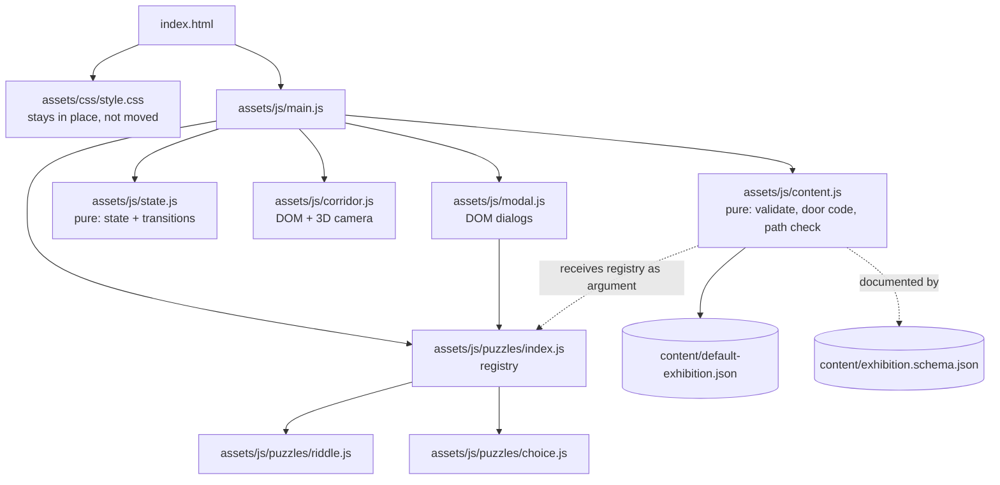
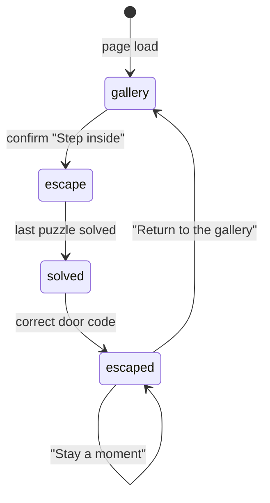
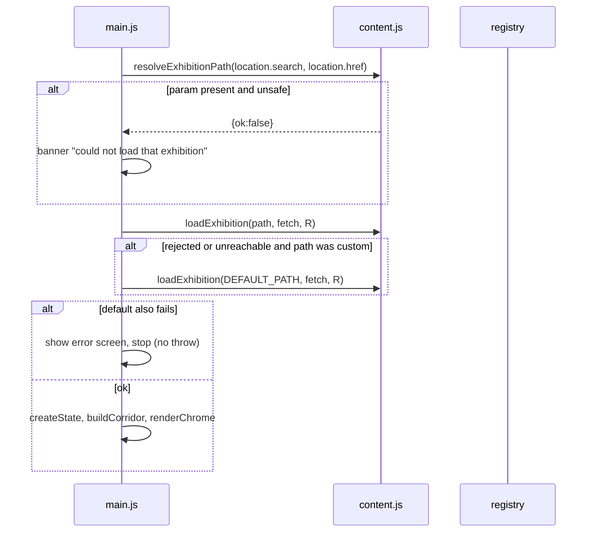

# Design Document: mvp-playable-loop

## Overview

This design turns the single-file prototype (`index.html`, `assets/css/style.css`, `assets/js/script.js`) into the first complete, data-driven Hexhibit playthrough: study in Daylight Mode, confirm the one-way switch, solve every puzzle in After-Hours Mode, enter the door code, escape, and return to the gallery.

What changes relative to the prototype:

- All lesson content moves into `content/default-exhibition.json`, validated on load against rules documented in `content/exhibition.schema.json`. A bad exhibition falls back to the default with a visible banner.
- The corridor is generated from the artwork count N (3 to 6). Corridor length, stop positions, door position, code length and counters all derive from N.
- Game flow lives in one `state` object with four explicit transitions (`gallery → escape → solved → escaped`, then `escaped → gallery`).
- Puzzles are plugged in through a registry. `riddle` and `choice` ship in this spec. Adding a type touches `assets/js/puzzles/` only.
- Logic that can be wrong without anyone noticing (validation, normalization, transitions, door code) is isolated in DOM-free modules and tested with `node --test` plus `fast-check` (dev-only).
- Prototype defects called out in the requirements are fixed: no theme restore, no auto-close on a correct answer, `--bad` token instead of `#e5484d`, square image corners, focus trap and focus return, 44px tap targets, and camera easing under `prefers-reduced-motion`.

Everything the prototype does visually stays. No new colors, fonts or component styles are introduced. The only new CSS is a small set of rules that reuse existing tokens (choice options, error banner, 44px minimums).

### Research summary

No web research was needed. The design rests on platform features already named in the tech steering, plus these findings from reading the prototype and requirements:

| Finding | Design consequence |
|---|---|
| Prototype builds the plaque with `innerHTML` from data. With `?exhibition=` loading untrusted JSON, that is an HTML injection path. | All exhibition text is written with `textContent` / `createElement`. Colors are validated as `#rrggbb` before they reach a `style` attribute. |
| Prototype appends `55` to a hex color for the gradient (`${c0}55`). | Colors must be 6-digit hex. The validator enforces `^#[0-9a-fA-F]{6}$`. |
| Prototype geometry for 6 artworks: stop `i` = `450*(i+1) − 190`, door stop 2800, exit stop 2950, back wall at z = −3200. | Constants `STOP_SPACING=450`, `STOP_OFFSET=190`, `DOOR_GAP=290`, `DOOR_VIEW_DIST=400`, `EXIT_OVERSHOOT=150` reproduce these numbers exactly at N=6. |
| `fetch` of JSON and ES modules do not work from `file://` in Chrome. | Static server required (requirements assumption A). README documents it. |
| WHATWG URL parsing strips tab/newline characters and treats `%2e%2e` as a `..` segment. | The `?exhibition=` check rejects control characters/whitespace and any `%`, and re-checks the resolved origin. |
| `"ß".toUpperCase().toLowerCase()` is `"ss"`, and `"İ".toLowerCase()` is two code points. | The riddle metamorphic property (9.7) cannot quantify over all Unicode. See Property 4. |

## Architecture

### Module map



Dependency rules:

- `content.js`, `state.js`, and the `evaluate`/`validate` functions of each puzzle handler are Pure_Logic_Modules. They touch no `document`, `window`, or `localStorage` at import time (Requirement 15.2). `content.js` never imports the registry. The registry is passed in as an argument, so tests can pass the real one or a stub.
- Handler files may reference `document` only inside `render`, so importing them in Node is safe.
- `corridor.js` knows nothing about puzzle types or game phases. It exposes geometry, camera, and callbacks. `main.js` is the only module that knows both state and DOM.
- `modal.js` gets handlers through the registry by `puzzle.type` and never branches on a type name (Requirement 8.4).

### State machine



Theme is derived from the phase (`gallery` is `light`, everything else is `dark`). Nothing is persisted, so every page load starts in `gallery` (Requirement 1.8). The prototype's `hx-theme` read and write are deleted, which removes the only `localStorage` use. No `localStorage` access remains in this spec; if one is added later it must sit in try/catch (Requirement 1.9).

### Boot sequence



### Key decisions

1. **State functions mutate one object and return a boolean.** The requirement says "a single `state` object". Transitions take `state`, mutate it in place, and return `true` if applied or `false` if refused (Requirement 6.8). This keeps one source of truth for the renderer and still makes transitions trivially testable.
2. **`escaped` is entered at the moment the correct code is accepted.** The state is the truth. The camera walk, door swing and the escaped dialog are presentation that follows. A `busy` flag in `main.js` (not in `state`) disables the theme button and ignores door activation until the escaped dialog is up. Under reduced motion, the delay constants collapse to a few hundred milliseconds.
3. **Type-specific validation lives in the handler.** Each handler exports `validate(puzzle, path)` returning error strings. `content.js` stays generic and a new puzzle type needs no change there (extends Requirement 8.5 to the loader).
4. **Dialog headings are generic chrome; dialog bodies come from `messages`.** The seven `messages` values are single strings (Requirement 2.2), so headings such as "Enter the escape room?" and "The archive door" are constants in `modal.js` next to "Check", "Hint" and "Continue" (assumption H). Allowing `messages` values to be `{title, body}` objects is a possible later schema extension and is not done here.
5. **No schema library.** Tech steering forbids new dependencies without asking. `exhibition.schema.json` is JSON Schema for documentation and editor tooling. The runtime validator is a small hand-written function, and a test keeps the two aligned (see Testing Strategy).
6. **Puzzle id equals Artwork id.** Each artwork owns one puzzle (assumption C), so the "revealed hint" set and "solved" set both store artwork ids.

## Components and Interfaces

### `assets/js/content.js` (pure, except `loadExhibition`'s injected `fetch`)

```js
export const DEFAULT_EXHIBITION_PATH = "content/default-exhibition.json";
export const MIN_ARTWORKS = 3, MAX_ARTWORKS = 6;
export const REQUIRED_MESSAGE_KEYS = [
  "enterEscape","doorLocked","doorUnlocked","staffOnly","escaped","doorNudge","digitsFound"
];

/** Same-site relative path check for ?exhibition=. Pure. */
export function resolveExhibitionPath(search, baseHref)
  // -> { ok:true, path:string|null }   (null = param absent, use default)
  //  | { ok:false, reason:string }

/** Validate parsed JSON. Never throws. */
export function validateExhibition(data, registry)
  // registry: { has(type):boolean, validate(type, puzzle, path):string[] }
  // -> { ok:true,  exhibition:data, doorCode:string }
  //  | { ok:false, errors:{path:string, message:string}[] }

export function computeDoorCode(artworks)      // artworks.map(a => a.puzzle.digit).join("")
export function fillTemplate(str, vars)        // replaces {found} and {total}
export function wallFor(index)                 // even -> "North Wall" (left), odd -> "South Wall"

/** Fetch + parse + validate. `fetchFn` is injected so Node tests need no network. */
export async function loadExhibition(path, fetchFn, registry)
  // -> same result shape as validateExhibition, plus
  //    { ok:false, errors:[{path:"(fetch)", ...}] } for network, status, or JSON parse failures
```

`validateExhibition` returns the input object untouched (no trimming, defaulting or field stripping). That is what makes the round-trip property (3.7) a plain deep-equality check, and it preserves unknown optional fields (Requirement 2.9). `doorCode` is returned beside the exhibition, not merged into it, for the same reason.

Rules enforced, each reported with a field path such as `artworks[1].puzzle.digit`:

- Root is a plain object with string `title`, object `messages`, array `artworks`.
- `messages` has all seven keys in `REQUIRED_MESSAGE_KEYS`, each a string. `digitsFound` need not be checked for placeholders.
- `3 ≤ artworks.length ≤ 6`.
- Each artwork: string `id` (non-empty, unique), `title`, `artist`, `year`, `medium`, `size`, `curatorNote`, `lesson`; `colors` is an array of exactly two `#rrggbb` strings; `puzzle` is an object.
- Puzzle common fields: string `type`, `prompt`, `hint`, `nudge`, `explanation`; `digit` is a string matching `^[0-9]$`.
- `registry.has(puzzle.type)` is true, otherwise the type is rejected by name.
- Type-specific errors come from `registry.validate(type, puzzle, path)`.

`year` is a string so that values such as `"c. 1884"` work, as in the prototype.

`resolveExhibitionPath(search, baseHref)` rejects, without fetching, a value that:

- is empty, or contains a control character or whitespace (`/[\u0000-\u0020\u007f]/`);
- starts with `//`, contains `\`, or contains `%` (blocks `%2e%2e` and double-encoding tricks);
- has a scheme (`/^[a-z][a-z0-9+.\-]*:/i`);
- contains a `..` segment after splitting on `/`;
- resolves, via `new URL(value, baseHref)`, to an origin different from `baseHref`'s origin (defense in depth).

A leading `/` (root-relative, same origin) is allowed; it is still same-site.

### `assets/js/state.js` (pure)

```js
export const PHASES = ["gallery","escape","solved","escaped"];

export function createState(artworkIds)
  // { phase:"gallery", artworkIds:[...], viewed:Set, solved:Set, hints:Set, currentIndex:0 }

export function themeFor(phase)                 // "light" | "dark"

// Transitions: mutate, return boolean (true = applied)
export function enterEscape(state)              // gallery -> escape
export function markSolved(state, id)           // escape only; id must be in artworkIds; -> solved when all solved
export function submitCode(state, input, doorCode)
  // -> "unsolved" | "wrong" | "correct"; "correct" also does solved -> escaped
export function returnToGallery(state)          // escaped -> gallery, clears viewed/solved/hints, currentIndex = 0

// Non-transition recorders
export function markViewed(state, id)           // gallery only; id must be in artworkIds
export function revealHint(state, id)           // escape or solved; id must be in artworkIds; idempotent
```

`markSolved` is the only way into `solved`, and it checks the id against `artworkIds`, so the solved set can never contain a foreign id (Requirement 6.10). `submitCode` returns `"unsolved"` in `escape` regardless of the input (Requirement 12.2), `"wrong"` for a mismatch in `escape`/`solved`, and in any other phase it returns `"wrong"` without changing state.

`submitCode` compares `input.trim()` to `doorCode` exactly. The keypad input is `inputmode="numeric"` text, so leading zeros survive.

### `assets/js/puzzles/index.js` (registry)

```js
import * as riddle from "./riddle.js";
import * as choice from "./choice.js";
const HANDLERS = { riddle, choice };

export function hasType(type)            // Object.hasOwn(HANDLERS, type)
export function getHandler(type)         // handler or undefined
export const registry = {                // shape expected by content.js
  has: hasType,
  validate: (type, puzzle, path) => getHandler(type).validate(puzzle, path)
};
```

`hasType` uses `Object.hasOwn`, so `"constructor"` and `"__proto__"` are not accepted as types.

**Handler contract** (each file under `assets/js/puzzles/` exports these):

```js
export const type = "riddle";
export function validate(puzzle, path)      // string[]  (pure)
export function evaluate(puzzle, answer)    // "correct" | "incorrect"  (pure)
export function render(root, puzzle, ctx)   // builds answer area in `root`
  // ctx: { onSubmit():void, idPrefix:string }
  // returns { getAnswer():any, focus():void }
```

- `riddle.js` also exports `normalize(s)`: `s.trim().replace(/\s+/g, " ").toLowerCase()`. `evaluate` returns `"correct"` when `normalize(answer)` equals `normalize(a)` for some `a` in `puzzle.answers`, and `"incorrect"` otherwise (including the empty string). `validate` requires `answers` to be a non-empty array of strings, each non-empty after `normalize`. Without that last rule, an author could write `""` as an accepted answer and an empty submission would be correct, which contradicts Requirement 9.6.
- `riddle.render` builds a `<label>` and `<input type="text" autocomplete="off">`. Enter calls `ctx.onSubmit`.
- `choice.js` `evaluate` returns `"correct"` iff `Number.isInteger(answer) && answer === puzzle.correctIndex`. `validate` requires `options` to be an array of 2 to 6 non-empty strings and `correctIndex` an integer in `[0, options.length)`.
- `choice.render` builds a `<fieldset>` with `<legend>` and one native `<input type="radio">` inside a `<label>` per option, in order. Native radios give arrow-key navigation, and the checked dot plus a 2px border on the selected label means selection is not color-only (Requirement 10.6). `getAnswer()` returns the selected index or `null`.

### `assets/js/modal.js` (DOM)

One dialog shell, as in the prototype (`#modal`, `.card`, `.x`), driven by builders:

```js
export function initModal(rootEl, { onClose })
export function openDialog(spec)
  // spec: { title, meta?, image?:{colors}, lines?:string[], plaque?:[label,value][],
  //         body?:(container)=>handle, actions:[{label, ghost?, onClick}],
  //         statusText?, returnFocusTo?:HTMLElement }
export function closeDialog()
export function setStatus(text, kind)    // kind: "ok" | "bad" | "hint" | "info"; shakes when "bad" unless reduced motion
export function isOpen()
```

Behavior (Requirement 13):

- On open: save `returnFocusTo ?? document.activeElement`; set `inert` on `.top`, `.viewport`, `.bar` (stops key walking and keeps focus inside); focus the first interactive control in the card; set `aria-labelledby` to the heading id.
- Tab and Shift+Tab wrap inside the card as a fallback for engines without `inert`.
- Escape and a click on the backdrop close the dialog. The close button is 44×44.
- On close: remove `inert`, restore focus to the saved element, and if that element is gone, to `#next`.
- All text goes through `textContent`. The artwork image is a `div` with the generated gradient and no `border-radius` (Requirement 5.6).
- `#fb` keeps `role="status"` and is never removed from the DOM, so announcements are reliable. `setStatus` writes text prefixed by a plain-text label ("Not quite.", "Correct.", "Hint:") so state is never color-only (Requirement 11.1, 13.10).

Scenes built on `openDialog` in `main.js`/`modal.js`: **plaque** (gallery), **puzzle**, **door**, **confirm** (enter escape), **staff-only**, **escaped**, **unlocked door**. The puzzle scene builds the answer area from `getHandler(puzzle.type).render(...)`, owns the Check, Hint and Continue buttons, and calls `evaluate`. When correct it keeps the dialog open, hides the answer area and Hint, writes the explanation and digit, and shows only Continue (Requirements 11.2, 11.4, 11.8).

In the `escaped` phase, activating the door opens the `doorUnlocked` message with "Return to the gallery" and "Stay a moment", the same buttons as the escaped dialog. The requirements define the `doorUnlocked` key but not this scene, so this is a design assumption (see Open points).

### `assets/js/corridor.js` (DOM + 3D)

```js
export const STOP_SPACING = 450;      // z distance between paintings (matches prototype)
export const STOP_OFFSET = 190;       // camera stops this far in front of the painting plane
export const DOOR_GAP = 290;          // last art stop -> door stop
export const DOOR_VIEW_DIST = 400;    // door stop -> back wall; keeps the door at the prototype's apparent size
export const EXIT_OVERSHOOT = 150;    // extra walk past the door once unlocked
export const ASSIST_BEHIND = 330, ASSIST_AHEAD = 90;  // click-assist window around a stop
export const FOCUS_RADIUS = 60, SNAP_RADIUS = 110, DOOR_NEAR = 200;
export const WALK_SPEED = 16, EASE_POS = 0.1, EASE_LOOK = 0.08, EASE_TURN = 0.1;
export const WALL_X = 244, TURN_DEG = 50;

export function computeLayout(n)
  // pure: { stops:number[], doorStop, exitStop, doorZ, length }
  // stops[i] = STOP_SPACING*(i+1) - STOP_OFFSET
  // doorStop = stops[n-1] + DOOR_GAP; exitStop = doorStop + EXIT_OVERSHOOT
  // doorZ = -(doorStop + DOOR_VIEW_DIST); length = |doorZ| + margin

export function artGradient(colors)   // same construction as the prototype, validated hex only

export function buildCorridor(exhibition, hooks, opts) -> corridor
  // hooks: { onArtwork(index), onDoor() }
  // corridor: { markDone(i), reset(), setDoorOpenable(bool), setLockLabel(text),
  //             walkTo(distance, {instant}), openDoor(), goHome(), destroy() }
```

`computeLayout(6)` yields stops `[260, 710, 1160, 1610, 2060, 2510]`, doorStop 2800, exitStop 2950, doorZ −3200, matching the prototype.

3D notes (these become code comments, Requirement 4.9):

- Camera is simulated by translating the whole `.world` toward the viewer by `d` (`translateZ(d)`) under a fixed `perspective: 750px`, so there is one transform to ease and no per-element math.
- Floor, ceiling and walls take their length from `computeLayout(n).length` through CSS custom properties (`--len`) and are shifted by half a length in z so the corridor always spans from just behind the camera start to the back wall. The prototype hard-codes 3600px planes centered on the origin, so implementation must compare N=6 with the prototype render and adjust the offset until they match.
- Artwork `i` sits on the left wall for even `i` and the right for odd `i`, at `x = side * WALL_X`, rotated `-side * 90deg` to face the walking line. The camera yaws up to `TURN_DEG` toward the painting it is stopped at, weighted by distance, so the "turn to face the painting" feel is continuous.
- Click assist: an artwork is `near` while `-ASSIST_BEHIND < d - stop < ASSIST_AHEAD`. The `::before` hit area (`inset:-24px`) stays.
- Activation: pointer or Enter on an artwork opens it immediately if `near`; otherwise the camera walks to that stop and then opens it (`pending` index, as in the prototype). Artworks get `tabindex="0"` and an `aria-label`. The door gets `tabindex="0"`, `role="button"`, an `aria-label`, and Enter/Space activation, which fixes a keyboard gap in the prototype.
- Reduced motion: when `matchMedia("(prefers-reduced-motion: reduce)")` matches, the loop sets `d = td`, `yaw = ty`, `pitch = tp`, `fy = target` directly. The listener is live, so toggling the OS setting takes effect without reload.
- `buildCorridor` removes previously created artwork elements first, so a fallback load after a failed one cannot duplicate paintings.

### `assets/js/main.js`

- Boots as in the sequence diagram, then wires: theme button, nav buttons, slots and counters, banner, and the scenes.
- `render()` is the only function that writes chrome from state: theme attribute, theme button label and `disabled`, progress text (`<viewed>/<N> artworks viewed` or `<solved>/<N> solved`), slots (N slots; solved ones show the digit), and the lock label.
- Door sequence on `submitCode === "correct"`: set `busy`, close dialog, `corridor.setDoorOpenable(true)`, `walkTo(exitStop)`, after `DOOR_SWING_DELAY` call `openDoor()`, after `ESCAPE_DIALOG_DELAY` open the escaped dialog and clear `busy`. Reduced-motion values are separate constants.
- Return to gallery: `returnToGallery(state)`, `corridor.reset()`, `walkTo(0, {instant:true})`, `render()`.

### Markup and CSS changes

`index.html`: the stylesheet link keeps pointing at `assets/css/style.css` (unchanged); `<script type="module" src="assets/js/main.js">`; the hard-coded `0/6 solved` becomes empty text filled by `render()`; a `#banner` element (`role="status"`) and a `#fatal` container are added; the dialog card gets `aria-labelledby` and `#fb` keeps `role="status"`.

`assets/css/style.css` (edited in place, not moved to the repo root):

- `.x`, `.btn`, `.tog`, `.card input`, and the choice option labels get `min-height:44px; min-width:44px`.
- `.fb.bad{color:var(--bad)}`, `.fb.ok{color:var(--accent)}`, `.fb.hint{color:var(--muted)}` replace the inline `#e5484d`.
- The inline `border-radius:8px` on the dialog image is removed and not reproduced in CSS.
- `.opt` (choice option label): 1px `--line` border, square corners, `accent-color: var(--accent)`; `.opt:has(input:checked)` gets `border-color:var(--ink)` and `border-width:2px`.
- `.banner`: top-anchored below `.top`, `--panel` background, 1px `--line` border, Antonio label, 44px dismiss button.
- Reduced motion: existing rule stays; add `.world{transition:none}` and `.shake{animation:none}` (already covered).
- Every new rule uses only existing tokens, so no new light/dark pair is needed (Requirement 1.5 applies only if one gets added during implementation).

### Package and test layout

```
package.json            { "type":"module", "scripts":{"test":"node --test"}, "devDependencies":{"fast-check":"^<current major>"} }
test/
  content.test.js       # example tests + Properties 1, 2
  state.test.js         # Properties 3, 5 + example tests
  riddle.test.js        # Property 4 + example tests
  choice.test.js
  helpers/arbitraries.js
```

`node --test` discovers `test/**` and `*.test.js` by default. The browser never requests `package.json`, `node_modules` or `test/`. Because `.gitginore` is misspelled, `node_modules/` is not currently ignored (see Open points).

## Data Models

### Exhibition JSON

```json
{
  "title": "The Corridor Remembers",
  "messages": {
    "enterEscape": "The lights will die and the doors will seal behind you...",
    "doorLocked": "The lock is cold. Solve every painting's puzzle to decipher the code.",
    "doorUnlocked": "The door stands open. The corridor remembers you.",
    "staffOnly": "The permanent archive is closed to visitors. Gallery hours: 10am to 6pm daily.",
    "escaped": "The door swings open and the cold air outside has never felt so good.",
    "doorNudge": "The lock does not move. Check the digits and their order.",
    "digitsFound": "You have found {found} of {total} digits."
  },
  "artworks": [
    {
      "id": "hollow-watcher",
      "title": "The Hollow Watcher",
      "artist": "Unknown",
      "year": "c. 1884",
      "medium": "Oil on canvas",
      "size": "92 x 76 cm",
      "curatorNote": "Note how the sitter's gaze seems to follow you.",
      "lesson": "Short placeholder lesson text.",
      "colors": ["#7a1f2b", "#120609"],
      "puzzle": {
        "type": "riddle",
        "prompt": "I have keys but no locks. What am I?",
        "answers": ["keyboard", "a keyboard"],
        "hint": "You are probably touching one right now.",
        "nudge": "Think about what sits under your hands.",
        "explanation": "A keyboard has keys, yet nothing to unlock.",
        "digit": "7"
      }
    }
  ]
}
```

The default file holds three artworks, at least one `riddle` and one `choice` (Requirement 2.7). A `choice` puzzle adds `options: string[]` and `correctIndex: number` instead of `answers`.

### Runtime shapes (JSDoc typedefs, no TypeScript)

```js
/** @typedef {"gallery"|"escape"|"solved"|"escaped"} Phase */
/** @typedef {{ phase:Phase, artworkIds:string[], viewed:Set<string>, solved:Set<string>,
 *             hints:Set<string>, currentIndex:number }} GameState */
/** @typedef {{ path:string, message:string }} ValidationError */
/** @typedef {{ ok:true, exhibition:object, doorCode:string }
 *          | { ok:false, errors:ValidationError[] }} LoadResult */
/** @typedef {"correct"|"incorrect"} PuzzleResult */
```

Invariants:

- `solved` and `viewed` are each subsets of `artworkIds`. A solved artwork need not have been viewed (a player can enter After-Hours without opening every plaque).
- `doorCode.length === artworks.length`, and `doorCode[i] === artworks[i].puzzle.digit`.
- `phase === "gallery"` implies `solved.size === 0` and `hints.size === 0`.

### Exhibition_Schema

`content/exhibition.schema.json` is JSON Schema (draft 2020-12). It lists the root, `messages` (seven required keys), artwork and puzzle fields, `puzzle` as a `oneOf`/`if-then` on `type` for `riddle` and `choice`, and `additionalProperties: true` on artwork and puzzle (Requirement 2.9). A `description` on the root states that the `?exhibition=` parameter is a testing aid and not a share link (Requirement 3.12).


## Correctness Properties

*A property is a characteristic or behavior that should hold true across all valid executions of a system-essentially, a formal statement about what the system should do. Properties serve as the bridge between human-readable specifications and machine-verifiable correctness guarantees.*

Randomized testing applies to the Pure_Logic_Modules only (`content.js`, `state.js`, `puzzles/riddle.js`). Corridor, dialogs, focus handling, motion and layout are UI and are covered by example checks in a browser (see Testing Strategy).

Reflection: 3.6 (door code computed on accept) is the same check as 3.8, so they share Property 2. Hint idempotence (11.6) is an operation inside the random sequences of Property 3, not a separate test. Choice evaluation (10.3) and the individual transitions (6.2 to 6.8) are simple enough for examples and are also exercised by Properties 3 and 5.

### Property 1: Exhibition round trip

*For any* valid Exhibition (3 to 6 artworks, unique ids, mixed `riddle` and `choice` puzzles, any unknown optional fields on the root, artworks and puzzles), loading `JSON.parse(JSON.stringify(exhibition))` through the validator succeeds and returns an exhibition deeply equal to the original.

**Validates: Requirements 3.7**

### Property 2: Door code is the digits in artwork order

*For any* valid Exhibition with N artworks, the accepted result's `doorCode` has length N, and for every index `i` in `[0, N)`, `doorCode[i]` equals `artworks[i].puzzle.digit`.

**Validates: Requirements 3.6, 3.8**

### Property 3: Phase and set invariants hold under any operation sequence

*For any* artwork id list and any sequence of operations drawn from `enterEscape`, `markViewed`, `markSolved`, `revealHint`, `submitCode` and `returnToGallery` (with ids that are valid or not in the list, and codes that are right or wrong), after every operation: `phase` is one of `gallery`, `escape`, `solved`, `escaped`; `solved` and `viewed` are subsets of the artwork ids; `hints` is a subset of the artwork ids; and a successful `returnToGallery` leaves the phase `gallery` with all three sets empty. Applying `revealHint` twice with the same id leaves `hints` equal to applying it once. An operation refused by the phase leaves the state deeply equal to its snapshot from before the call.

**Validates: Requirements 6.2, 6.8, 6.10, 11.6**

### Property 4: Riddle answers ignore case and surrounding whitespace

*For any* non-empty accepted answer built from ASCII letters, digits, punctuation and single or repeated whitespace, *for any* per-character upper or lower casing of it, and *for any* leading and trailing whitespace, `evaluate` returns `"correct"` when the answer list contains the original accepted answer. Additionally, *for any* string that normalizes to the empty string, `evaluate` returns `"incorrect"`.

The generator is limited to ASCII on purpose. Unicode case mapping is not reversible (`"ß"` uppercases to `"SS"` and lowercases to `"ss"`), so a claim over all Unicode would be false. An example test records that limit and that the comparison still lowercases both sides.

**Validates: Requirements 9.2, 9.3, 9.6, 9.7**

### Property 5: Door submission succeeds only in `solved` with the exact code

*For any* artwork id list, phase, door code and input string: `submitCode` returns `"correct"` and moves the phase to `escaped` if and only if the phase is `solved` and `input.trim() === doorCode`. In `escape` it returns `"unsolved"` even when the input equals the door code. In every other case it returns `"wrong"` (or `"unsolved"` in `escape`) and leaves the state unchanged.

**Validates: Requirements 6.5, 6.6, 12.2, 12.3, 12.4**

## Error Handling

| Situation | Behavior |
|---|---|
| `?exhibition=` value is unsafe (scheme, `//`, backslash, `..`, `%`, whitespace, cross-origin) | Not fetched. Banner: a friendly "could not load that exhibition, showing the default" message. Default exhibition loads. |
| Custom exhibition fetch fails (network, non-2xx) or JSON does not parse | Same banner, default loads. The result carries a `(fetch)` error so tests can assert it. |
| Custom exhibition fails validation | Same banner. Banner text lists up to the first 3 field paths, with a "Show all" disclosure for the rest, so authors can fix the file. |
| Default exhibition fails to fetch or validate | Full-page friendly error naming the problem (for example "The built-in exhibition could not be loaded") and the first error paths. No exception escapes `main.js`; boot is wrapped in try/catch that renders this screen. |
| Unregistered puzzle `type` | Rejected by validation with the type name and path. A handler is never looked up for an unknown type at play time. |
| `localStorage` unavailable | Not used in this spec. |
| Browser has no `inert` support | Tab-wrap fallback in `modal.js` keeps focus inside the dialog. |
| Reduced motion toggled mid-session | Live `matchMedia` listener switches easing and delays. |
| Exhibition text contains markup | Rendered as text (`textContent`), never as HTML. |

Console cleanliness (Requirement 3.9, 13.11): the code never calls `console.error` and catches every promise rejection in boot. When a fetch returns 404, Chrome itself logs a "Failed to load resource" line for the network request. That is browser output the app cannot suppress, so the zero-console-errors check applies to rejected content, unsafe parameters, and a full playthrough, and the README documents that a missing file shows a browser network line.

## Testing Strategy

### Why two kinds of tests

Pure logic gets unit and property tests in Node. Rendering, 3D and dialogs are UI, so property-based testing does not apply there. They get a written browser checklist, as the tech steering requires ("verify in a browser at desktop and phone widths").

### Property-based tests

- Library: `fast-check`, listed under `devDependencies` only. No other package is added. The runner is the built-in `node --test`; no transpile or build step.
- Each of Properties 1 to 5 is implemented by **one** `fc.assert(fc.property(...))` call with at least 100 runs (the fast-check default is 100; set `numRuns: 100` explicitly or higher so a library change cannot lower it).
- Each test carries a comment tag: `// Feature: mvp-playable-loop, Property N: <title>`.
- Shared arbitraries in `test/helpers/arbitraries.js`:
  - `validExhibition`: N from 3 to 6; ids from `fc.uniqueArray`; seven message strings; colors from three hex-pair draws; puzzle either riddle (answers whose normalized form is non-empty) or choice (2 to 6 options and an in-range `correctIndex`); digit from `"0"` to `"9"`. Unknown optional fields use keys prefixed `x_` with string or integer values only, so `JSON.stringify` cannot change them (`-0`, `NaN` and `undefined` do not survive JSON).
  - `opSequence(ids)`: arrays of operation descriptors mixing valid ids, random ids, right and wrong codes.
- Tests use the real registry from `assets/js/puzzles/index.js`. That import is safe in Node because handlers touch `document` only inside `render`.

### Example-based tests (Requirement 15.6 and others)

- Rejection table for 3.2: missing top-level field, missing each `messages` key, wrong field type, 2 and 7 artworks, duplicate ids, `digit` of `"10"`, `""`, `"a"` and `7` (number), unknown puzzle type, bad hex color, empty accepted riddle answer. Each asserts the error path.
- 3.3: `correctIndex` of `-1`, `options.length`, and `1.5`.
- 3.11: `https://x.test/a.json`, `HTTP://x`, `//x.test/a.json`, `a\\b.json`, `../a.json`, `a/../b.json`, `%2e%2e/a.json`, `javascript:alert(1)`, a tab/newline-containing value, and an empty value. Accepted: `content/other.json`, `/content/other.json`.
- `loadExhibition` with a stub `fetch`: non-2xx, thrown error, and invalid JSON each return `ok:false` with a `(fetch)` error.
- State transitions one by one, including refusals from the wrong phase.
- `fillTemplate`, `wallFor`, `computeLayout(3)` and `computeLayout(6)` (the latter equals the prototype numbers 260 to 2510, door 2800, exit 2950).
- Default exhibition validates, has 3 artworks, and contains both puzzle types.
- Schema guard: `REQUIRED_MESSAGE_KEYS` equals the `messages.required` list in `exhibition.schema.json`, so the documentation cannot drift from the validator.

### Browser checklist (manual, before each task is marked done)

- Full keyboard playthrough: gallery, confirm, solve every puzzle, door, escape, return.
- 390px, 768px, 1440px in both themes: no horizontal scroll, no clipped controls, all tap targets at least 44px.
- Dialog: focus enters, Tab wraps, Escape closes, focus returns to the opener.
- `prefers-reduced-motion: reduce`: no flicker, no door swing, camera jumps to its target.
- Contrast of body text, muted text and status text in both themes (4.5:1 minimum).
- `?exhibition=` with a valid file, an invalid file, a missing file and an unsafe value: banner shown, default loaded, no uncaught errors.
- Console is empty through a complete loop.
- N=3 default plus a temporary N=6 file that reproduces the prototype geometry.

### What is deliberately not tested automatically

DOM construction, CSS and 3D transforms. Adding a DOM test harness would need a dependency (jsdom or a browser driver), which the steering forbids without asking.

## Open points for review

1. **`escaped` entered immediately on a correct code.** The camera walk and door swing play afterwards while `busy` blocks input (Key decision 2). The alternative, delaying the transition until the animation ends, leaves a window where the state is `solved` but the door is opening.
2. **Dialog headings are constants in `modal.js`.** The requirements make `messages` values plain strings. If you want authors to control headings too, the schema needs `{title, body}` message objects.
3. **`doorUnlocked` scene is my addition.** The requirements define the key but no behavior. The design uses it when the door is activated in the `escaped` phase.
4. **Riddle validation rejects accepted answers that are blank after normalization.** This is stricter than Requirement 3.2's wording, and needed so an empty submission cannot be correct (9.6).
5. **`.gitginore` is misspelled**, so `node_modules/` will not be ignored once `npm install` runs. Outside this spec, but worth renaming to `.gitignore` before the first install.
6. **Corridor plane geometry** in the prototype CSS looks centered on the origin at 3600px, which does not obviously cover a back wall at z = −3200. The implementation task should render N=6 next to the prototype and match it before trusting `--len`.
