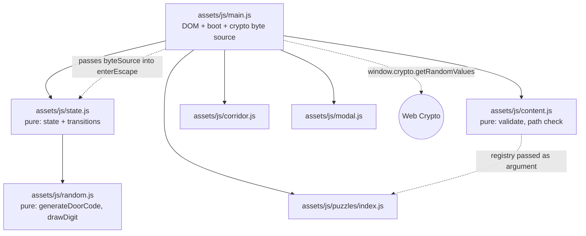

# Design Document: per-game-door-code

## Overview

Spec 1 (`mvp-playable-loop`) fixed the door code in the exhibition file: each puzzle carried a `digit`, and `content.js` joined them. Every player of the same exhibition got the same code. This spec moves the code into the game. When the player confirms "Step inside", the state generates one random code, keeps it in the single `state` object for that game, and drops it when the player returns to the gallery.

What changes relative to spec 1:

| Area | Spec 1 | This spec |
|---|---|---|
| Code source | `computeDoorCode(artworks)` in `content.js` joins puzzle digits | `generateDoorCode(source, n)` in new `assets/js/random.js` |
| Loader result | `{ ok, exhibition, doorCode }` | `{ ok, exhibition }` |
| `digit` field | Required, validated `^[0-9]$` | Optional, deprecated, never read |
| `enterEscape` | `enterEscape(state)` | `enterEscape(state, source)`; generates first, then changes phase |
| `submitCode` | `submitCode(state, input, doorCode)` | `submitCode(state, input)`; compares with `state.doorCode` |
| Digit shown in UI | `p.puzzle.digit` | `revealedDigit(state, index)` |
| Default exhibition | 3 artworks | 6 artworks, no `digit` |
| Randomness | none | `window.crypto.getRandomValues`, built in `main.js` only |

Nothing visual changes except the three new paintings. The new browser check (Requirement 6.7) may find existing corridor defects. A defect is reported, not fixed (see Ceiling and back-wall check).

### Research summary

No web research was needed. The design rests on the current code and these findings:

| Finding | Design consequence |
|---|---|
| `Math.random` is not cryptographically strong and cannot be seeded in tests. | The generator takes a `Random_Source` argument. `main.js` supplies `crypto.getRandomValues`; tests supply deterministic sources. |
| `byte % 10` over 0..255 favors digits 0 to 5 (26 values each versus 25). | Rejection sampling: bytes 250 to 255 are discarded. 250 is a multiple of 10, so each digit maps from exactly 25 bytes. |
| `crypto.getRandomValues` needs no setup and works on `http://localhost` and `https`. | No fallback to `Math.random`. If it is missing, `enterEscape` throws and the player stays in the gallery (see Error Handling). |
| In the current `style.css`, `.ceiling` has `height: 3600px`, `top: -1800px`, no `--len`/`--zc`, and its `transform` is commented out (`assets/css/style.css`). Floor and walls use `--len` and `--zc`. | The ceiling is probably not a ceiling today. The browser check is designed to record that as a finding. |
| `JSON.stringify` turns `-0` into `0` and drops `undefined`/`NaN`. | The round-trip generator normalizes arbitrary `digit` values through one `JSON.parse(JSON.stringify(v))` before use. |
| `node:crypto` exports `webcrypto` on every supported Node version, while the global `crypto` is missing on older Node. | The crypto-backed test imports `webcrypto` from `node:crypto`. |

## Architecture

### Module map



Dependency rules:

- `random.js` imports nothing. It has no `document`, `window`, `crypto` or `Math.random` reference, so it imports and runs in Node.
- `state.js` imports only `random.js`. It never sees `crypto`; the source arrives as an argument.
- `content.js` no longer knows anything about door codes.
- `main.js` is the only module that touches `crypto`. It contains no generation logic: no byte mapping, no retry, no fix-up.
- `corridor.js`, `modal.js` and the puzzle handlers are unchanged.

### Enter-escape sequence (generate before transition)

```mermaid
sequenceDiagram
  participant P as Player
  participant M as main.js
  participant S as state.js
  participant R as random.js
  participant C as crypto
  P->>M: click "Step inside"
  M->>S: enterEscape(state, byteSource)
  alt phase is not gallery
    S-->>M: false (source not called)
  else phase is gallery
    S->>R: generateDoorCode(byteSource, artworkIds.length)
    loop draw bytes until accepted
      R->>M: byteSource()
      M->>C: getRandomValues(Uint8Array(1))
      C-->>M: byte
      M-->>R: byte (0 to 255)
    end
    alt generator throws (bad N, bad byte, too many rejects, crypto missing)
      R-->>S: throws
      S-->>M: throws (state untouched, phase still gallery)
      M->>M: keep dialog open, setStatus("could not set the lock")
    else success
      R-->>S: doorCode
      S->>S: doorCode = code; phase = "escape"
      S-->>M: true
      M->>M: closeDialog(); render()
    end
  end
```

`enterEscape` assigns `doorCode` and `phase` together as its last two statements. Everything that can throw runs before them, so a failure leaves the state untouched (Requirement 2.10).

### Key decisions

1. **Code lives in `state`, not beside it.** One source of truth (tech steering). `state.doorCode` is `null` in `gallery` and a string in every other phase.
2. **`submitCode` loses its `doorCode` parameter.** The caller can no longer pass a different code than the game's (Requirement 4.5).
3. **`revealedDigit(state, index)` is the only read path for a digit.** It returns the character only if the artwork at `index` is solved, otherwise `null`. This makes "unsolved digits never reach the DOM" a property of a pure function instead of a convention in `main.js`.
4. **Retries before fix-up.** Retrying keeps the distribution near uniform. Fix-up only runs after 11 all-identical attempts (1 initial plus `MAX_ALL_SAME_RETRIES` = 10 retries), and consumes no randomness, so termination is guaranteed.
5. **One error type for bad source values.** A value that is not an integer in 0..255 throws `TypeError`. Bad `n` throws `RangeError`. Running out of accepted bytes throws `Error`. Tests assert "throws", with `RangeError` checked only where Requirement 1.7 names it.

## Components and Interfaces

### `assets/js/random.js` (new, pure)

```js
export const MIN_CODE_LENGTH = 3;        // equals MIN_ARTWORKS in content.js (a test asserts this)
export const MAX_CODE_LENGTH = 6;        // equals MAX_ARTWORKS
export const BYTE_MAX = 255;
export const REJECT_FROM = 250;          // bytes 250..255 are discarded; 250 is a multiple of 10
export const MAX_DRAWS_PER_DIGIT = 100;  // consecutive discarded bytes tolerated for one digit
export const MAX_ALL_SAME_RETRIES = 10;  // regenerations before the fix-up

/** Draw one digit 0..9 by rejection sampling. Exported for the bias test.
 *  @param {() => number} source  returns an integer 0..255 per call
 *  @returns {number} 0..9 */
export function drawDigit(source)

/** Generate a door code for n artworks.
 *  @param {() => number} source
 *  @param {number} n  integer 3..6
 *  @returns {string}  n characters, each "0".."9", never all identical */
export function generateDoorCode(source, n)
```

Behavior of `drawDigit(source)`:

1. If `typeof source !== "function"`, throw `TypeError`.
2. `rejected = 0`. Loop: `b = source()`.
3. If `!Number.isInteger(b) || b < 0 || b > BYTE_MAX`, throw `TypeError` (covers `-1`, `256`, `1.5`, `NaN`, `"7"`, `undefined`). `Number.isInteger("7")` is `false`, so strings fail without a separate check.
4. If `b < REJECT_FROM`, return `b % 10`.
5. Otherwise `rejected += 1`; if `rejected >= MAX_DRAWS_PER_DIGIT`, throw `Error` ("random source returned only discarded bytes"). Else continue. A source that always returns 255 is called exactly 100 times, then throws.

Behavior of `generateDoorCode(source, n)`:

1. If `!Number.isInteger(n) || n < MIN_CODE_LENGTH || n > MAX_CODE_LENGTH`, throw `RangeError` before calling `source`.
2. For `attempt = 0 .. MAX_ALL_SAME_RETRIES` (11 attempts): build `digits` of length `n` from `n` calls of `drawDigit`; if the digits are not all equal, return `digits.join("")`.
3. After the last attempt, still all equal (digit `d`): apply the fix-up. Replace the last digit with `(d + 1) % 10` and return it. A constant source therefore yields, for example, `"778"` for `n = 3` and byte 7, after exactly `11 * n` source calls.
4. No module-level state: the result depends only on the byte sequence and `n` (Requirement 1.3).

The returned value is a `string`, so `"007"` keeps its leading zeros.

### `assets/js/state.js` (changed, pure)

```js
import { generateDoorCode } from "./random.js";

export function createState(artworkIds)
  // { phase:"gallery", artworkIds:[...], viewed:Set, solved:Set, hints:Set, currentIndex:0, doorCode:null }

export function enterEscape(state, source)
  // phase !== "gallery" -> return false; source NOT called
  // else code = generateDoorCode(source, state.artworkIds.length)  // may throw; nothing mutated yet
  //      state.doorCode = code; state.phase = "escape"; return true

export function submitCode(state, input)
  // "escape" -> "unsolved" (even if input equals the code)
  // "solved" -> String(input).trim() === state.doorCode ? (phase = "escaped", "correct") : "wrong"
  // "gallery" | "escaped" -> "wrong", no change

export function returnToGallery(state)
  // escaped -> gallery; clears viewed, solved, hints; doorCode = null; currentIndex = 0; return true
  // other phases -> false, no change

export function revealedDigit(state, index)
  // -> the character state.doorCode[index] if doorCode !== null, index is an integer in
  //    [0, artworkIds.length), and state.solved has state.artworkIds[index]; otherwise null
```

`markSolved`, `markViewed`, `revealHint`, `themeFor` and `PHASES` are unchanged. State invariants (new items in bold):

- `solved`, `viewed`, `hints` are subsets of `artworkIds`.
- **`doorCode === null` if and only if `phase === "gallery"`.**
- **When not `null`, `doorCode.length === artworkIds.length`, every character is `0` to `9`, and the characters are not all identical.**
- **`doorCode` is the same string in `escape`, `solved` and `escaped` within one game.**

If `artworkIds.length` is outside 3 to 6, `enterEscape` propagates the generator's `RangeError` and the state stays in `gallery` (Requirement 2.10).

### `assets/js/content.js` (changed, pure)

Removed: `const DIGIT`, the `puzzle.digit` check in `validatePuzzle`, `computeDoorCode` and its export, and the `doorCode` field of the success result.

```js
export function validateExhibition(data, registry)
  // -> { ok:true, exhibition:data } | { ok:false, errors:[{path,message}] }
export async function loadExhibition(path, fetchFn, registry)   // same result shape
```

`digit` is never read, so `"x"`, `12`, `null`, `{}` and absence are all accepted. `validateExhibition` still returns the input object itself, so unknown optional fields and `digit` survive untouched (Requirement 5.5, 5.7). Every other rule (title, messages, 3 to 6 artworks, unique ids, colors, puzzle strings, registry check, `resolveExhibitionPath`, `fillTemplate`, `wallFor`) is unchanged (Requirement 5.8). The file comment "The registry is passed in..." stays.

### `assets/js/main.js` (changed)

Removed: `CODE` variable and its assignment (`CODE = out.res.doorCode`). Added:

```js
// Random_Source for the generator: one byte per call from the browser's CSPRNG.
// No Math.random fallback: if crypto is missing, enterEscape throws and the player stays in the gallery.
const byteSource = () => {
    const b = new Uint8Array(1);
    window.crypto.getRandomValues(b);
    return b[0];
};
// Shown when the lock cannot be set (no crypto, or the generator threw).
const LOCK_FAILED_TEXT = "The lock would not set. Please try again.";
```

Call-site changes (each is a read of the session code in place of a read from the exhibition):

| Location in `main.js` | Before | After |
|---|---|---|
| `let EX, P, CODE, corridor` | declares `CODE` | `CODE` removed |
| `boot()` | `CODE = out.res.doorCode` | line removed |
| `render()`, slots | `isSolved(i) ? p.puzzle.digit : "•"` | `const d = revealedDigit(S, i); e.className = "slot" + (d !== null ? " on" : ""); e.textContent = d ?? "•"` |
| `pick()`, solved view | `` `... Digit ${pz.digit}.` `` | `` `... Digit ${revealedDigit(S, i)}.` `` |
| `check()`, puzzle solved | `` `... Digit ${pz.digit} revealed.` `` | `` `... Digit ${revealedDigit(S, cur)} revealed.` `` (after `markSolved`) |
| `check()`, door | `submitCode(S, input, CODE)` | `submitCode(S, input)` |
| `$("theme").onclick`, "Step inside" | `closeDialog(); enterEscape(S); render()` | `try { enterEscape(S, byteSource) } catch { setStatus(LOCK_FAILED_TEXT, "info"); return } closeDialog(); render()` |

Leak rules for Requirement 2.8 and 3.4:

- `main.js` never logs, never writes the code into an attribute, `data-*`, `aria-label`, `title` or the URL, and never calls `localStorage`/`sessionStorage`. The `catch` block binds no error and logs nothing.
- The state object `S` is module-scoped (`let S` in an ES module), so it is not reachable as `window.S`.
- The slot text and the dialog text receive only the return value of `revealedDigit`, which is `null` for unsolved artworks. An unsolved digit is never a string in any DOM-writing code path.
- The `setStatus` call in the failure path uses the `"info"` kind, because the `"bad"` kind adds a "Not quite." prefix that would blame the player for a system fault. `modal.js` already supports `"info"` with an empty prefix. The call sits inside the still-open confirm dialog, so the player can retry or choose "Stay in the gallery".

### Schema and README changes (documentation only)

`content/exhibition.schema.json`:

- Root `description`: replace "The door code is the puzzle digits in artwork order." with "The door code is generated by the game each time the player steps inside; exhibitions do not contain it."
- Puzzle `required`: `["type", "prompt", "hint", "nudge", "explanation"]` (drop `"digit"`).
- Puzzle `properties.digit`: remove `type` and `pattern`; set `"deprecated": true` and `"description": "Deprecated and ignored. The door code is generated for each game. Any value is accepted."`
- `additionalProperties: true` stays on artwork and puzzle.
- The `REQUIRED_MESSAGE_KEYS` guard test is unchanged.

`README.md`:

| Place | Change |
|---|---|
| Intro paragraph | Add one sentence: the door code is new for every game. |
| Tests section | "...state transitions and door code" becomes "...state transitions and the door code generator". |
| Repository layout | Add `random.js` under `assets/js/`; list the new test files. |
| Authoring paragraph (line 65) | Remove "each puzzle has a single-character `digit`. The door code is the digits in artwork order." Add: the game generates the door code for each game; `digit` is optional and ignored if present; the default exhibition has 6 artworks and an exhibition may have 3 to 6. |
| Riddle and choice examples | Delete the `"digit"` line and the comma at the end of the `explanation` line above it, so the JSON stays valid. |

### Default exhibition (data only): `content/default-exhibition.json`

Six artworks. The three existing ones keep every field except `digit`, which is deleted (and the comma on the preceding line). The three new ones use short placeholder text in the existing voice ("Placeholder note: ...", "Placeholder lesson: ..."), the same field set as the existing ones, and no `digit`. The `messages` object is unchanged.

| # | `id` | Title | Type | Prompt sketch (answer) | Colors (generated gradient) |
|---|---|---|---|---|---|
| 1 | `the-patient-watcher` | The Patient Watcher | riddle | existing (keyboard) | existing |
| 2 | `lantern-at-low-tide` | Lantern at Low Tide | choice | existing (Moon's gravity) | existing |
| 3 | `the-quiet-staircase` | The Quiet Staircase | riddle | existing (echo) | existing |
| 4 | `the-cartographers-window` | The Cartographer's Window | choice | Where does the Sun rise? East is `correctIndex: 2` of 4 options | `#5e3a2b`, `#150b07` |
| 5 | `the-clock-without-hands` | The Clock Without Hands | riddle | "I have hands but cannot clap. What am I?" (`clock`, `a clock`) | `#3a3a4a`, `#0c0c10` |
| 6 | `the-last-candle` | The Last Candle | choice | What does a flame need to keep burning? Oxygen is `correctIndex: 1` of 4 options | `#6b5a2e`, `#100d05` |

Counts: 3 riddle, 3 choice (at least 2 of each). Ids are unique. No gore, no emoji. The three new artworks supply `artist`, `year`, `medium`, `size`, `curatorNote`, `lesson`, `hint`, `nudge`, `explanation` as placeholders. The existing wall alternation (`wallFor`) gives three paintings per wall. `computeLayout(6)` already reproduces the prototype geometry (stops 260 to 2510, door stop 2800, door z -3200), so no corridor code changes.

### Ceiling and back-wall check (Requirements 6.7 and 6.8)

This is a manual browser check, not an automated test. A DOM harness would need a new dependency.

Static reading of the current CSS (not a result):

- `.floor`, `.wall-left`, `.wall-right` are sized with `--len` and moved to `--zc`, so they should reach the back wall at `--door-z`.
- `.ceiling` has `width: 500px; height: 3600px; top: -1800px`, ignores `--len` and `--zc`, and its `transform` is commented out. As written it is an unrotated vertical slab in the plane z = 0, not a ceiling. Even if the commented transform were restored, a plane centered at z = 0 and 3600px long would span z = ±1800 and stop short of the back wall at z = -3200.
- So a ceiling finding is expected, and the check must confirm or refute it with evidence.

Procedure:

1. Serve the repo with a static server (README command) and open `http://localhost:8080/` in Chrome.
2. For each size 390x844, 768x1024, 1440x900 and each theme (light = gallery; dark = after pressing "Step inside"), 6 combinations in all:
   1. Confirm six slots (dark) and six paintings, no horizontal scrollbar, and no clipped control (nav, theme button, Back/Next, slots).
   2. Go to the first stop (press Next once) and then the door stop (press Next seven times in total).
   3. At each of the two positions, inspect the four surfaces. In DevTools, temporarily apply distinct backgrounds (floor, ceiling, left wall, right wall, back wall) to make gaps obvious. These edits are not saved and no repo file changes.
   4. Read `getComputedStyle` for `.ceiling` (`transform`, `height`, `top`) and the same for `.floor` to record the cause with evidence.
   5. A surface passes if it is visible as that surface and meets the back wall with no visible gap at both positions.
3. Record results in `.kiro/specs/per-game-door-code/verification.md`: one row per size/theme/position with pass or fail for floor, ceiling, left wall, right wall, plus a "cause" column and any screenshot file names.
4. Any fail is written as a finding (combination plus cause) and reported to the user. It is not skipped, not hidden by editing the check, and not fixed under this spec. A fix needs a separate decision from the user. The one-line fix candidate (`--len`/`--zc` sizing and restoring the transform) may be named in the finding as an option only.
5. The same session verifies the gameplay checks that need a browser: unsolved digits absent from the DOM (inspect `#slots` and, with the dialog open, the card), no console output across a full loop, the code differing between two games, and "Step inside" failing cleanly when `window.crypto` is temporarily replaced in DevTools by `undefined`-returning stubs.

## Data Models

```js
/** @typedef {() => number} RandomSource   one integer 0..255 per call */
/** @typedef {"gallery"|"escape"|"solved"|"escaped"} Phase */
/** @typedef {{ phase:Phase, artworkIds:string[], viewed:Set<string>, solved:Set<string>,
 *             hints:Set<string>, currentIndex:number, doorCode:string|null }} GameState */
/** @typedef {{ ok:true, exhibition:object } | { ok:false, errors:{path:string,message:string}[] }} LoadResult */
```

Exhibition shape: spec 1's, except `puzzle.digit` is optional and may hold any JSON value (ignored).

Test stand-ins (in `test/helpers/sources.js`):

| Helper | Behavior |
|---|---|
| `constantSource(b)` | always returns `b`; counts calls |
| `cyclingSource(bytes)` | returns `bytes[i++ % bytes.length]` |
| `sequenceSource(bytes)` | returns the next byte; throws when exhausted |
| `scriptedSource(bytes)` | like `sequenceSource`; used for the retry-success case |
| `prngSource(seed)` | small seeded generator (mulberry32) returning bytes; used for the variation property |

## Correctness Properties

*A property is a characteristic or behavior that should hold true across all valid executions of a system-essentially, a formal statement about what the system should do. Properties serve as the bridge between human-readable specifications and machine-verifiable correctness guarantees.*

Randomized testing applies to `random.js`, `state.js`, `content.js` and `puzzles/riddle.js`. DOM, corridor and dialog behavior are UI and use the browser checklist.

Reflection: criteria 1.10 and 1.11 and 2.2 to 2.6 are exercised inside one state-sequence property (Property 8) instead of one property each. Property 2 and Property 3 are kept apart from Property 1 even though one test could check all three, because Requirement 8.1 names each of them. Spec 1's Property 4 (riddle) is restated here as Property 10 because this spec implements it (Requirement 8.4).

### Property 1: A generated code is never all-identical

*For any* source byte sequence (including constant sources) and any N from 3 to 6, `generateDoorCode` returns a code whose characters are not all equal.

**Validates: Requirements 1.12, 1.13**

### Property 2: Code length equals the artwork count

*For any* source byte sequence and any N from 3 to 6, `generateDoorCode(source, N).length === N`.

**Validates: Requirements 1.1, 1.14**

### Property 3: Every code character is a digit

*For any* source byte sequence and any N from 3 to 6, every character of the returned code is one of `0` to `9`, and the result is a `string`.

**Validates: Requirements 1.1, 1.15, 2.9**

### Property 4: Equal byte sequences give equal codes

*For any* byte sequence and any N from 3 to 6, two fresh sources that yield that same sequence give identical codes.

**Validates: Requirements 1.3, 1.16**

### Property 5: Different sources are not all the same

*For any* set of at least 50 distinct seeds and any N from 3 to 6, the codes produced from `prngSource(seed)` for those seeds are not all identical. The test does not assert that two consecutive codes differ.

**Validates: Requirements 1.17**

### Property 6: Mapping matches the reference model

*For any* stream of (0 to 5 discarded bytes in 250..255, then one accepted byte in 0..249) groups, the code from `generateDoorCode` equals the model: take accepted bytes mod 10, chunk into groups of N, return the first chunk that is not all-identical; if the first 11 chunks are all-identical, return the 11th with its last digit replaced by `(d + 1) % 10`.

**Validates: Requirements 1.5, 1.12**

### Property 7: Exhibition round trip, with or without `digit`

*For any* valid Exhibition (3 to 6 artworks, unique ids, mixed riddle and choice puzzles, optional `x_`-prefixed unknown fields, and a `digit` that is absent or any normalized JSON value on each puzzle), loading `JSON.parse(JSON.stringify(exhibition))` succeeds, returns an object deeply equal to the original, and the result has no `doorCode` field.

**Validates: Requirements 5.3, 5.4, 5.5, 5.7**

### Property 8: State invariants hold under any operation sequence

*For any* artwork id list of length 3 to 6, any source byte sequence, and any sequence of `enterEscape`, `markViewed`, `markSolved`, `revealHint`, `submitCode` and `returnToGallery` calls (valid and invalid ids, right and wrong codes), after every operation: the phase is one of the four phases; `solved`, `viewed`, `hints` are subsets of the ids; `doorCode` is `null` exactly when the phase is `gallery`; a non-null `doorCode` has length N, digits only, and is not all-identical; `doorCode` is unchanged by every operation except a successful `enterEscape` (set) and a successful `returnToGallery` (cleared); `revealedDigit(state, i)` is `null` when the artwork at `i` is unsolved and equals `doorCode[i]` when it is solved; an operation refused by the phase leaves the state deeply equal to its snapshot, and a refused `enterEscape` made zero source calls.

**Validates: Requirements 1.10, 1.11, 2.2, 2.3, 2.4, 2.5, 3.1, 3.4, 8.3**

This also implements spec 1 criterion 6.10.

### Property 9: Door submission succeeds only in `solved` with the session code

*For any* state in any phase with a stored code, and any input string (including the right code padded with whitespace and wrong codes of the same length), `submitCode(state, input)` returns `"correct"` and moves to `escaped` if and only if the phase is `solved` and `input.trim() === state.doorCode`. In `escape` it returns `"unsolved"` even when the input equals the code. Otherwise it returns `"wrong"` (or `"unsolved"` in `escape`) and leaves the state unchanged.

**Validates: Requirements 4.1, 4.2, 4.3, 4.4, 4.5**

### Property 10: Riddle answers ignore case and surrounding whitespace

*For any* non-empty accepted answer built from ASCII letters, digits, punctuation and runs of whitespace, any per-character casing of it, and any leading and trailing whitespace, `evaluate` returns `"correct"` when the answer list contains the original; *for any* string that normalizes to empty, `evaluate` returns `"incorrect"`. The generator is ASCII-only because Unicode case mapping is not reversible (for example `"ß"`); an example test records that limit.

**Validates: Requirements 8.4**

This also implements spec 1 criteria 9.2, 9.3, 9.6 and 9.7.

## Error Handling

| Situation | Behavior |
|---|---|
| `generateDoorCode` called with N not an integer 3..6 | Throws `RangeError` before calling the source. |
| Source is not a function, or returns a non-integer or a value outside 0..255 | Throws `TypeError`; no code returned. |
| Source returns 100 discarded bytes in a row | Throws `Error`; no endless loop. |
| Code is all-identical | Retry up to 10 times, then fix-up. Never throws, always terminates, consumes at most `11 * N` accepted draws. |
| `enterEscape` while phase is not `gallery` | Returns `false`; source not called; state unchanged. |
| Generator throws inside `enterEscape` | Error propagates; `phase`, `doorCode`, `solved` unchanged. |
| `window.crypto` missing or `getRandomValues` throws in the browser | `byteSource` throws, `enterEscape` throws, `main.js` catches without logging, keeps the confirm dialog open, and shows `LOCK_FAILED_TEXT` via `setStatus(..., "info")`. The `"info"` kind is already supported by `modal.js` (`STATUS_PREFIX.info` is `""`), so no "Not quite." prefix is added, no shake runs (only `bad` shakes), and the text uses the base `.fb` styling with no extra color rule. No `modal.js` or CSS change is needed. The player can retry or stay in the gallery. No `Math.random` fallback. |
| `digit` present with any value | Ignored. No error, no warning. |
| Spec 1 exhibition files that still contain `digit` | Load normally. |
| Ceiling or other corridor surface fails the browser check | Recorded as a finding in `verification.md` and reported to the user. Not fixed under this spec. |

Console cleanliness: the new code adds no `console` calls. The `catch` in the "Step inside" handler is parameterless.

## Testing Strategy

PBT applies to the pure logic (`random.js`, `state.js`, `content.js`, `riddle.js`). It does not apply to rendering, the corridor, dialogs or the crypto call itself; those get example tests or the browser checklist.

### Property-based tests

- Library: `fast-check` (already a dev dependency in `package.json`). Runner: `node --test`. No new dependency (Requirement 8.13).
- Each of Properties 1 to 10 is a single `fc.assert(fc.property(...), { numRuns: 100 })` (or more).
- Each test has a tag comment: `// Feature: per-game-door-code, Property N: <title>`.
- Shared arbitraries in `test/helpers/arbitraries.js`:
  - `byteSeq`: `fc.tuple(fc.array(fc.integer({min:0,max:255}), {maxLength:80}), fc.integer({min:0,max:249})).map(([a,b]) => [...a, b])`. At most 80 bytes plus one accepted byte, so a cycling source never sees 100 consecutive discarded bytes. Includes constant-like arrays through fast-check's own bias.
  - `n`: `fc.integer({min:3,max:6})`.
  - `groupedStream` for Property 6, built as described in the property.
  - `validExhibition` (from spec 1's design) with `digit`: `fc.option(fc.jsonValue().map(v => JSON.parse(JSON.stringify(v))), {nil: undefined})`, set only when defined. The normalization removes `-0`.
  - `opSequence(ids)`: arrays of operation descriptors that mix valid and unknown ids, right and wrong codes. A sequence step for `submitCode` reads the current `state.doorCode` to build a right code.

### Example and edge-case tests

| Requirement | Test |
|---|---|
| 8.5 fix-up | `constantSource(b)` for every N in 3..6 and a few `b`: code not all-identical; last digit equals `(b % 10 + 1) % 10`; leading digits equal `b % 10`; source called exactly `11 * N` times; returns. |
| 8.6 retry success | `scriptedSource`: first N bytes all `3`, next N bytes `1,2,...`. Expect the exact varied code, `2 * N` calls, no fix-up applied. Also a variant that succeeds on the last allowed retry (11th attempt). |
| 8.7 state examples | Validation accepts no `digit`, `"x"`, `12`, `null`, `{}`; `enterEscape` stores a code of length N; wrong-phase `enterEscape` leaves the counting source at 0 calls; `returnToGallery` clears the code; `submitCode` uses the stored code; `createState` has `doorCode: null`; second game gets a new code from a different source. |
| 8.8 generator edge cases | `RangeError` for N = 2, 7, 3.5, `NaN`. Throws for source values `-1`, `256`, `1.5`, `NaN`, `"7"`, `undefined`. `constantSource(255)` throws after exactly 100 calls. |
| 8.9 enterEscape failure | Throwing source, invalid-value source, and a state with 2 or 7 artwork ids: each throws, and `phase`, `doorCode`, `solved` are unchanged. |
| 8.10 crypto and bias | Crypto: build a source from `webcrypto.getRandomValues(new Uint8Array(1))` in the test, call `generateDoorCode` for N 3..6, assert length and characters. This proves the contract, not the exact `main.js` function (that is in the browser checklist). Bias: `drawDigit` over a source yielding bytes `0..249` once each gives each digit exactly 25 times; a source yielding `250..255` then `7` returns `7` after 7 calls. |
| 8.11 replaced test | No existing test file is edited. `test/smoke.test.js` stays. |
| 1.2, 1.4, 3.5, 5.6, 1.6 | `test/hygiene.test.js` reads the source text with comments stripped: `random.js` has no `Math.random`, `crypto`, `window`, `document`; `main.js` contains no `.digit` and no `console.`; `content.js` has no `computeDoorCode` and no `DIGIT`; `main.js` contains no `% 10` and no `getRandomValues` loop other than the one-byte `byteSource`. Imports of `random.js` and `state.js` succeed in Node. A crude comment stripper is acceptable here because these files contain no `//` inside strings. |
| 5.1, 5.2 | The schema JSON: puzzle `required` has no `digit`; `properties.digit.deprecated === true`; no `type` on `digit`; `additionalProperties` is true. |
| 6.1 to 6.6 | The default file: 6 artworks, unique ids, 3 existing ids kept, at least 2 riddle and 2 choice, no `digit` key anywhere, seven message keys, passes `validateExhibition` with the real registry. |
| 7.4 | The schema root description contains "generated" and not "puzzle digits in artwork order". |
| `MIN_CODE_LENGTH`, `MAX_CODE_LENGTH` | Equal `MIN_ARTWORKS`, `MAX_ARTWORKS` from `content.js`. |

### Test files

```
test/
  random.test.js       # Properties 1 to 6; examples 8.5, 8.6, 8.8, 8.10
  state.test.js        # Properties 8, 9; examples 8.7, 8.9
  content.test.js      # Property 7; digit examples; default exhibition; schema guards
  riddle.test.js       # Property 10; Unicode-limit example
  hygiene.test.js      # source-text checks
  helpers/arbitraries.js
  helpers/sources.js
```

`node --test` passes on a clean checkout after `npm install` with no browser (Requirement 8.12).

### Browser checklist (manual, recorded in `verification.md`)

- Full keyboard playthrough with the new code: solve all six puzzles, read each revealed digit, enter the six-digit code, escape, return, step inside again, and confirm the new code differs.
- Unsolved digits absent from the DOM: inspect `#slots` and the open dialog at several points; text shows only bullets and solved digits.
- Console empty through a full loop; no storage entries created (Application tab).
- Crypto failure path: with `window.crypto` stubbed, "Step inside" keeps the dialog open and shows the failure text.
- The 6-combination size/theme check and the ceiling and back-wall check from Components and Interfaces.
- Spec 1 accessibility checks unchanged: focus trap, Escape, reduced motion, 44px targets, contrast (Requirement 8.14).

### Requirement 8 coverage

| Req 8 | Covered by |
|---|---|
| 8.1 | Properties 1 to 5 (1.13 to 1.17) |
| 8.2 | Property 7 |
| 8.3 | Property 8 |
| 8.4 | Property 10 |
| 8.5 | Fix-up example |
| 8.6 | Retry-success example |
| 8.7 | State and validation examples |
| 8.8 | Generator edge-case examples |
| 8.9 | `enterEscape` failure example |
| 8.10 | Crypto example and bias example |
| 8.11 | No existing test edited |
| 8.12 | Plain `node --test`, no browser |
| 8.13 | No new dependency; hygiene test blocks `console.` in `main.js` |
| 8.14 | Browser checklist |

## Traceability

| Requirement | Design section |
|---|---|
| 1.1 to 1.5, 1.7 to 1.9 | Components: `random.js`; Properties 2, 3, 6 |
| 1.6 | Components: `main.js` (`byteSource`); hygiene test |
| 1.10, 1.11 | Components: `state.js`; Enter-escape sequence; Property 8 |
| 1.12 to 1.17 | Components: `random.js` (retry and fix-up); Properties 1 to 5 |
| 2.1 to 2.6 | Components: `state.js`; Enter-escape sequence; Property 8 |
| 2.7, 2.8 | Components: `main.js` leak rules; browser checklist |
| 2.9 | Components: `random.js` (string result); Property 3 |
| 2.10 | Enter-escape sequence; Error Handling; example 8.9 |
| 3.1 to 3.3 | Components: `main.js` call-site table; `revealedDigit` |
| 3.4 | `revealedDigit`; Property 8; browser checklist |
| 3.5 | `main.js` call-site table; hygiene test |
| 3.6 | Unchanged (`modal.js`); browser checklist |
| 4.1 to 4.5 | Components: `state.js` (`submitCode`); Property 9 |
| 4.6 | Unchanged; browser checklist |
| 5.1, 5.2 | Schema and README changes; schema example test |
| 5.3 to 5.5, 5.7 | Components: `content.js`; Property 7 |
| 5.6, 5.8 | Components: `content.js`; hygiene and content examples |
| 6.1 to 6.6 | Default exhibition table; default-file examples |
| 6.7, 6.8 | Ceiling and back-wall check; `verification.md` |
| 7.1 to 7.4 | Schema and README changes |
| 7.5, 7.6 | Requirements document (already in place); no design work |
| 8.1 to 8.14 | Testing Strategy: Requirement 8 coverage |

## Open points for review

1. **Fix-up is only reached after 11 all-identical attempts.** With real randomness that happens about once in 10^22 games for N = 3 (each attempt is all-identical with probability 1/100), so it is a termination guarantee, tested only through constant sources.
2. **`revealedDigit` is an addition beyond the requirements' wording.** Requirement 3 allows a getter or field; the getter returns `null` for unsolved artworks so the DOM code cannot show an unsolved digit by mistake.
3. **Failure text lives in `main.js`.** `LOCK_FAILED_TEXT` follows the existing `SOLVE_FIRST_TEXT` precedent. It is not in the exhibition because it is a system message, not lesson content.
4. **The ceiling is expected to fail the check.** If it does, the finding goes to you for a decision; this spec does not change `style.css` or `corridor.js`.
5. **Spec 1 already says `escaped` is entered immediately on a correct code.** Unchanged here, and the session code stays valid until `returnToGallery`.
